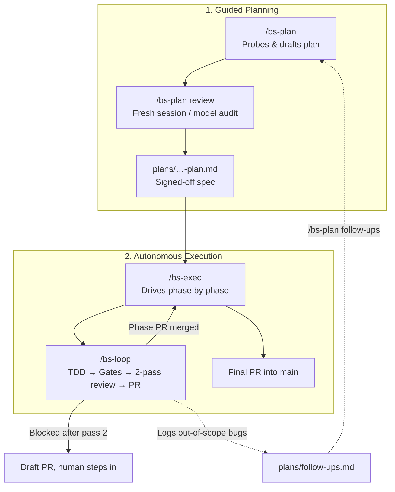

# Agentic Development Bootstrap

A complete starter kit, workflow engine, and runtime environment for building software autonomously with coding agents (Claude Code, Antigravity, OpenAI Codex, OpenCode, Pi, Cursor, and Copilot).

It gives you three things:

1. **A project scaffold** — One command sets up a new repository with an agent rulebook (`AGENTS.md`), pre-commit quality gate (`lefthook`), CI, and a `plans/` architecture structure.
2. **Global `bs-*` skills** — `/bs-plan`, `/bs-exec`, and `/bs-loop` for full plan-to-PR automation, plus `/bs-probe`, `/bs-task`, and `/bs-review` for lightweight ad-hoc development, installed once per machine.
3. **A turnkey agent container** — An isolated Docker runtime in `docker/` combining **T3 Code** (orchestrator), web-based VS Code (`code-server`), and configurable worker harnesses with skills pre-baked.

---

## Quick Start

### 1. Choose Your Environment

#### Option A: Local Machine (Install Once)
Installs skills into your local AI tools:

```bash
cd ~/dev/bootstrap
./install.sh
```
*The installer automatically detects your installed tools and registers the skills. Installed skills are copies, so re-run `./install.sh` after pulling to update them.*

#### Option B: Docker Agent Server (Isolated / Homelab)
Spins up a headless server with T3 Code and web-based VS Code:

```bash
cd ~/dev/bootstrap/docker
cp .env.example .env   # then set PASSWORD in .env
docker compose up -d
docker compose exec agent t3-pair
```
*Click the generated URL to open T3 Code on your laptop or phone.*

### 2. Scaffold a New Project

```bash
# Continuous release (apps, websites, games, microservices)
~/dev/bootstrap/init.sh ~/dev/my-app --type continuous

# Versioned release (libraries, compilers, packages with SemVer)
~/dev/bootstrap/init.sh ~/dev/my-lib --type versioned
```
*If any scaffold file already exists in the target, `init.sh` stops and lists them; pass `--force` to overwrite.*

### 3. Configure the Quality Gate

1. Fill in every `[PLACEHOLDER]` in `AGENTS.md` and `.github/workflows/ci.yml`, and adjust `.github/dependabot.yml` (remove the npm entry if the project does not use npm).
2. In `lefthook.yml`, specify your project's formatting, linting, and test commands (and mirror them under **Commands** in `AGENTS.md`). Leave the `extends: - lefthook-bootstrap.yml` line in place: that file holds the shared commit-message check and is kept up to date by `sync.sh`.
3. Ensure [lefthook](https://github.com/evilmartians/lefthook) (`brew install lefthook` or `npm i -D lefthook && lefthook install`) and [gitleaks](https://github.com/gitleaks/gitleaks) 8.19+ are installed.

*The quality gate intentionally blocks commits until configured, preventing unverified code from slipping through.*

---

## How the Agentic Workflow Works

The `bs-*` skills divide work into composable stages. For full features, `/bs-plan` is interactive, while `/bs-exec` and `/bs-loop` run autonomously until a PR is merged or a review gate blocks it. For ad-hoc local work without plans or PRs, use `/bs-probe`, `/bs-task`, and `/bs-review` directly.



| Skill | Role | Output |
| :--- | :--- | :--- |
| **`/bs-plan`** | Probe the codebase, define scope boundaries, and split work into small TDD phases (`review` audits a plan; `follow-ups` schedules logged bugs by root cause) | Verified design plan in `plans/` |
| **`/bs-exec`** | Orchestrate an approved plan phase by phase on `feat/<plan-slug>`, then audit the full branch | One reviewed PR per phase + CI-verified final PR into `main` |
| **`/bs-loop`** | Implement a single phase or standalone task by orchestrating `/bs-task`, `/bs-review`, and `/bs-probe` through a PR and 2-pass review | Tested, AI-reviewed PR (CI-verified for standalone tasks) |
| **`/bs-task`** | Single-task TDD implementation with root-cause checks and quality gates (used standalone on current branch or per task inside `/bs-loop`) | Verified local changes (optional safe commit) |
| **`/bs-review`** | Fresh-context, probe-verified AI code review for local diffs, branches, or PRs (supports `--pairing`; also drives `/bs-loop` Pass 1) | Review findings (`High`/`Medium`/`Low`/`Out of Scope`) |
| **`/bs-probe`** | Read-only root-cause investigation using `.probes/` and sibling-path checks (used standalone or inside `/bs-plan`, `/bs-task`, and `/bs-review`) | Root cause, minimal repro, and probe evidence |

> [!NOTE]
> Agents never commit on their own. Invoking `/bs-loop` or `/bs-exec` grants explicit permission to branch, commit, push, and open PRs according to the workflow rules.

### 1. `/bs-plan` — Probe Before You Build
Probes the codebase empirically to prove every claimed problem exists before drafting architecture. Defines what is in and out of scope, establishes falsifiable done criteria, and splits work into atomic phases small enough for a single PR. This is the human-in-the-loop stage: the skill stops and asks you on every scope or design trade-off, and you commit the plan before handing it to `/bs-exec`.
```text
/bs-plan Add WebSocket reconnection with exponential backoff
/bs-plan in gofront: Implement the encoding/csv stdlib package
/bs-plan review plans/v1.8.0/portable-go-plan.md       # Audit & tighten in a fresh session/model
/bs-plan follow-ups plans/v1.8.0/portable-go-plan.md   # Turn follow-ups.md into fix phases, grouped by root cause
```

### 2. `/bs-exec` — Phase-by-Phase Orchestration
Operates on a dedicated `feat/<plan-slug>` branch and runs `/bs-loop` for each phase, checking off `- [x] Task N.M` boxes as commits land so interrupted runs resume seamlessly. Pauses after each phase PR for human merge, or merges passing phases automatically with `--auto`. If a phase PR is blocked by the review gate, it halts (even with `--auto`), leaves the PR in Draft, and alerts you to step in. Phase PRs rely on the local quality gate and skip cloud CI (the scaffolded workflow skips branches with `phase` in their name); full CI runs on the final PR. Finishes with follow-up triage, release-note polishing, and a full-branch audit against the plan.
```text
/bs-exec plans/v1.8.0/portable-go-plan.md
/bs-exec --auto plans/v1.8.0/portable-go-plan.md
```

### 3. `/bs-loop` — From Failing Test to Reviewed PR
1. **TDD (`/bs-task` & `/bs-probe`):** Runs `/bs-task` for the standalone task or for each `Task N.M` in a plan phase (which uses `/bs-probe` when isolating root causes), writing a failing test first and the minimal implementation to pass.
2. **Quality Gate & Docs:** Runs the project's pre-commit gate and updates `CHANGELOG.md` / user docs when behavior changed.
3. **Draft PR:** Pushes the branch and opens a draft PR.
4. **2-Pass Fresh AI Review (`/bs-review` & `/bs-probe`):** Pass 1 runs `/bs-review` in a fresh reviewer context with active `/bs-probe` verification in `.probes/`. High/Medium findings get at most one fix turn, after which a *new* fresh reviewer verifies the fixes. Pass 2 is terminal: `LGTM` passes the gate; anything unresolved leaves the PR in Draft as `BLOCKED_BY_DEFECTS` for you to investigate. Out-of-scope bugs are logged to `plans/follow-ups.md`.
5. **CI Gate:** For a standalone task, waits for remote CI checks before marking the PR ready. A plan's phase PRs skip this step; CI runs on the plan's final PR instead.

### 4. Ad-Hoc Local Workflow (`/bs-probe`, `/bs-task`, `/bs-review`)
Use these when you want fast, local iteration without design plans, Draft PRs, or automated fix loops:
```text
/bs-probe Why does config merge drop nested overrides?
/bs-task Fix nested config merge in loader.go
/bs-review                    # Branch commits + uncommitted changes
/bs-review #42                # A pull request
/bs-review main...feat/x      # A branch range
/bs-review --pairing          # Review with a different tool
```

You don't need a clean working tree for these. `/bs-task` works on your current branch next to your own uncommitted edits: it commits only when you ask, commits only its own files, won't commit a file you were already editing, and tells you when its checks ran with your edits present. `/bs-review` covers your uncommitted changes too, and if anything in your working tree changes during the review, it lists the changed files and leaves them as they are.

### Multi-Model Pairing
Pair different model families so the reviewer doesn't share the implementer's blind spots. `--pairing` keeps the tool you are in as implementer and picks the first other available tool (Claude Code, Antigravity, then Codex) as reviewer; `--implementer` and `--reviewer` name them explicitly. A paired tool runs on a default model (`claude-sonnet-5-5` for Claude, `gemini-4-hydrogen` for Antigravity, `gpt-6-luna` for Codex) unless you pass `--implementer-model` or `--reviewer-model`:
```text
/bs-loop --pairing Fix race condition in session cleanup
/bs-loop --implementer=claude --reviewer=agy --reviewer-model=gemini-4-hydrogen Fix race condition in session cleanup
/bs-exec --auto --pairing plans/v1.8.0/portable-go-plan.md
```

- The defaults are configured in `workflows/shared/models.env`. To change one without modifying this repo, set it in `${XDG_CONFIG_HOME:-~/.config}/bootstrap/models.env` and re-run `./install.sh`; names you leave out keep the repo default:
  ```sh
  BS_MODEL_AGY="<model-id>"   # also BS_MODEL_CLAUDE, BS_MODEL_CODEX
  ```
  The defaults are deliberately mid-tier models rather than each provider's most capable one: plans split the work into small phases, so each diff is small enough for them to handle well, which keeps paired runs fast and cheap. They apply only to the paired tool; the tool you are in keeps your session's model. Pass a model flag for a stronger model on large or risky changes.
- If no other tool is available, `--pairing` warns and reviews with the tool you are in.
- A model is never swapped silently: if the one you asked for, or a default, is unavailable, that role stops and tells you.
- When the tool you are in implements, it writes the code on your session's model; `--implementer-model` then applies only to the fix turn after review.
- Inside T3 Code (see the Docker agent server below), paired roles run as live threads you can watch instead of background CLI runs.

> [!WARNING]
> During pairing, the paired tool's CLI runs headless, without interactive permission prompts. For full isolation, run paired workflows inside the Docker container.

---

## Managing Plans, Rules & Multi-Repo Sync

All planning artifacts for agents live in `plans/`, keeping `docs/`, `README.md`, and `CHANGELOG.md` strictly for human readers:

```text
Versioned (Libraries / Compilers):       Continuous (Apps / Sites / Services):
plans/                                   plans/
  roadmap.md                               roadmap.md
  template.md                              template.md
  follow-ups.md                            follow-ups.md
  v1.0.0/                                  archive/
    auth-redesign-plan.md                    completed-feature-plan.md
  v1.1.0/                                  active-feature-plan.md
    websocket-support-plan.md
```

- **`AGENTS.md` is the single source of truth:** Part 1 holds universal workflow rules; Part 2 holds project commands and architecture. Tool bridge files (`CLAUDE.md`, `.github/copilot-instructions.md`) simply point to it, and Cursor reads it natively.
- **Keep every repository in sync with `sync.sh`:**
  ```bash
  ./sync.sh             # Syncs every sibling repo in ~/dev containing an AGENTS.md
  ./sync.sh --dry-run   # Preview changes without modifying files
  ./sync.sh --check     # Quality gate mode: exits 1 if any repository has drifted
  ./sync.sh ~/dev/app   # Target specific repositories
  ```
  `sync.sh` propagates `scaffold/AGENTS.md` Part 1, bridge files, `plans/template.md`, `lefthook-bootstrap.yml`, and the `# >>> bootstrap-managed` `.gitignore` block without touching project-specific Part 2 rules or your `lefthook.yml`.

---

## Supported Tools & Harnesses

| Tool / CLI | Skill Location | Review Mode |
| :--- | :--- | :--- |
| **Google Antigravity (`agy`)** | `~/.gemini/config/skills/` | Native subagents + CLI pairing |
| **Claude Code (`claude`)** | `~/.claude/skills/` & `~/.claude/commands/` | Native subagents + CLI pairing |
| **OpenAI Codex (`codex`)** | `~/.codex/skills/` | Native subagents + CLI pairing |
| **OpenCode (`opencode`)** | `~/.config/opencode/skills/` | Own subagents if available, else paired CLI review |
| **Pi (`pi`)** | `~/.pi/agent/skills/` | Own subagents if available, else paired CLI review |
| **Cursor (`cursor`)** | `~/.cursor/rules/*.mdc` | Own subagents if available, else paired CLI review |
| **GitHub Copilot / VS Code (`code`)** | User prompt files (`.prompt.md`) | Own subagents if available, else paired CLI review |

---

## Docker Agent Server (`docker/`)

For homelabs, remote servers, or sandboxed execution, `docker/` provides an isolated container running **T3 Code** (orchestrator), **code-server** (VS Code in the browser), and configurable worker harnesses (`claude`, `codex`, `opencode`, `pi`, `agy`) with the bootstrap skills pre-installed.

- **Security:** Both web UIs bind to `127.0.0.1` by default, and `docker compose` requires `PASSWORD` to be set in `docker/.env` before starting.
- **Networking & Workers (`docker/.env`):**
  ```bash
  CODE_SERVER_HOST_PORT=8002           # Host port for VS Code web (default 8080)
  T3_HOST_PORT=8012                    # Host port for T3 Code (default 8011)
  CODE_SERVER_BIND=0.0.0.0             # Expose on LAN (default 127.0.0.1)
  T3_BIND=0.0.0.0                      # Expose on LAN (default 127.0.0.1)
  T3_BASE_URL=http://my-host.lan:8012  # URL minted in t3-pair links
  ENABLED_WORKERS=claude,codex,agy     # Available: claude, codex, opencode, pi, agy, all
  ```
- **Maintenance:** Install a worker dynamically with `docker compose exec agent harness-install codex`, upgrade in-place with `./upgrade.sh` (or `agent-upgrade` inside the container), or rebuild from scratch with `./rebuild.sh`.

---

## Repository Layout

```text
bootstrap/
├── docker/             Turnkey agent container (T3 Code, code-server, workers, upgrade scripts)
├── scaffold/           Template files copied into new projects by init.sh
├── workflows/          Everything install.sh deploys machine-wide
│   ├── skills/         Universal AI skills (rendered by install.sh into each detected tool)
│   │   ├── bs-plan/SKILL.md
│   │   ├── bs-exec/SKILL.md
│   │   ├── bs-loop/SKILL.md
│   │   ├── bs-task/SKILL.md
│   │   ├── bs-review/SKILL.md
│   │   └── bs-probe/SKILL.md
│   └── shared/         Installed next to the skills in ${XDG_DATA_HOME:-~/.local/share}/bootstrap/
│       ├── conventions.md  Shared worker conventions
│       ├── dispatch.md     Orchestrator dispatch rules
│       └── models.env      Default paired model names (overridable in ${XDG_CONFIG_HOME:-~/.config}/bootstrap/models.env)
├── install.sh          Installs skills and shared docs across detected AI tools
├── init.sh             Scaffolds a new project (--type continuous|versioned)
├── sync.sh             Synchronizes shared rules across projects (--check, --dry-run)
└── AGENTS.md           Agent guide for this repository
```
