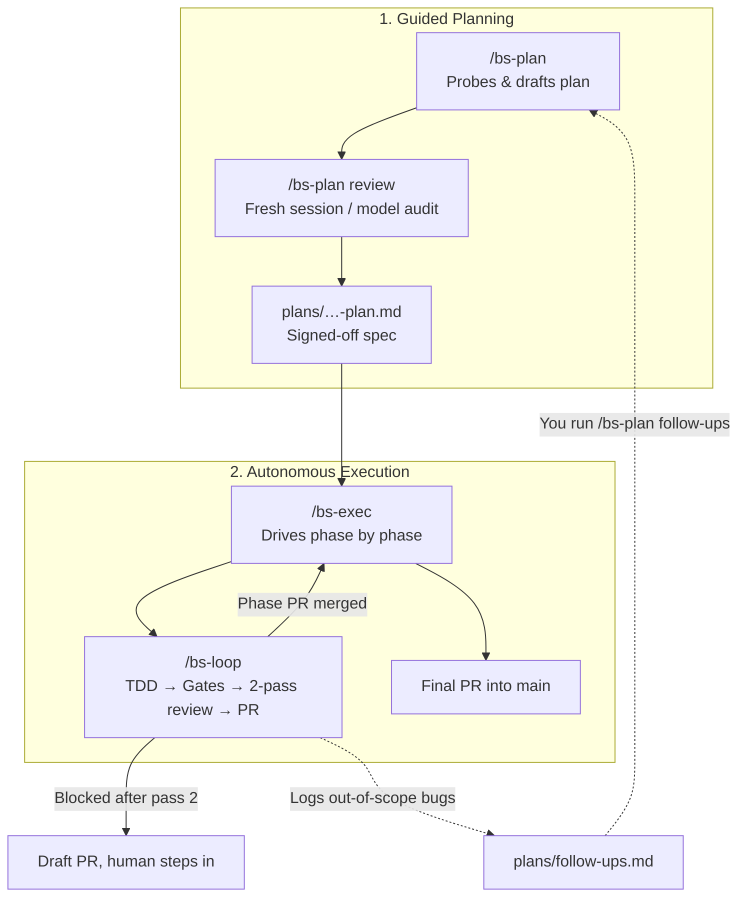

# Agentic Development Bootstrap

A starter kit, workflow engine, and Docker runtime for building software autonomously with coding agents (Claude Code, Antigravity, OpenAI Codex, and Copilot).

1. **Project scaffold (`init.sh`)** — Sets up a repository with an agent rulebook (`AGENTS.md`), pre-commit quality gate (`lefthook`), CI, and a `plans/` workspace.
2. **Global `bs-*` skills (`install.sh`)** — `/bs-plan`, `/bs-exec`, and `/bs-loop` for plan-to-PR automation, plus `/bs-probe`, `/bs-task`, and `/bs-review` for local ad-hoc work.
3. **Turnkey agent container (`docker/`)** — An isolated server running **T3 Code**, web-based VS Code (`code-server`), and configurable worker CLIs with skills pre-installed.

---

## Quick Start

### 1. Choose Your Environment

#### Option A: Local Machine
Requires `bash`, `git`, `python3`, and `gh` (for PR workflows).

```bash
cd ~/dev/bootstrap
./install.sh
```
*Detects installed AI tools and copies the skills into each. Re-run `./install.sh` after pulling to update skills and prune retired ones.*

#### Option B: Docker Agent Server
```bash
cd ~/dev/bootstrap/docker
cp .env.example .env   # set PASSWORD in .env
docker compose up -d
docker compose exec agent t3-pair
```
*Open the generated pairing URL to access T3 Code from your laptop or phone.*

### 2. Scaffold a New Project

```bash
# Continuous release (apps, sites, games, services)
~/dev/bootstrap/init.sh ~/dev/my-app --type continuous

# Versioned release (libraries, compilers, packages with SemVer)
~/dev/bootstrap/init.sh ~/dev/my-lib --type versioned
```
*Stops if any target file already exists; pass `--force` to overwrite.*

### 3. Configure the Quality Gate

1. Replace every `[PLACEHOLDER]` in `AGENTS.md` and `.github/workflows/ci.yml`, and trim `.github/dependabot.yml` if you don't use npm.
2. Set your format, lint, and test commands in `lefthook.yml` (mirror them under **Commands** in `AGENTS.md`). Keep `extends: - lefthook-bootstrap.yml` for the shared commit-message check.
3. Install [lefthook](https://github.com/evilmartians/lefthook) (`lefthook install`) and [gitleaks](https://github.com/gitleaks/gitleaks) 8.19+.

*The gate blocks commits until configured.*

---

## How the Agentic Workflow Works



| Skill | Role | Output |
| :--- | :--- | :--- |
| **`/bs-plan`** | Probe the codebase, set scope boundaries, and split work into small TDD phases (`review` audits a draft; `follow-ups` schedules logged bugs) | Verified plan in `plans/` |
| **`/bs-exec`** | Drive an approved plan phase by phase on `feat/<plan-slug>`, then open the final PR into the base branch | Reviewed phase PRs + final merge PR |
| **`/bs-loop`** | Run a single phase or standalone task via T3 Code workers through TDD, gates, draft PR, 2-pass review, and CI | Tested, AI-reviewed, CI-verified PR |
| **`/bs-task`** | Single-task local TDD implementation on your current branch (works inline in any tool; no PR) | Verified local changes |
| **`/bs-review`** | Fresh-context, probe-verified AI review via T3 Code for local diffs, branches, or PRs | `High` / `Medium` / `Low` / `Out of Scope` report |
| **`/bs-probe`** | Read-only root-cause investigation using throwaway probes in `.probes/` | Root cause, repro, and sibling checks |

> [!NOTE]
> Agents never commit on their own. Invoking `/bs-loop` or `/bs-exec` authorizes branching, committing, pushing, and managing PRs per the workflow rules.

### 1. `/bs-plan` — Probe Before You Build
Empirically probes the codebase to prove every gap before drafting architecture, scope boundaries, and atomic TDD phases. Interactive: stops on design trade-offs, and you commit the plan before running `/bs-exec`.

```text
/bs-plan Add WebSocket reconnection with exponential backoff
/bs-plan in gofront: Implement the encoding/csv stdlib package
/bs-plan review plans/v1.8.0/portable-go-plan.md       # Audit in a fresh session/model
/bs-plan follow-ups plans/v1.8.0/portable-go-plan.md   # Re-probe & schedule logged bugs
```

### 2. `/bs-exec` — Phase-by-Phase Execution
Runs `/bs-loop` for each unchecked phase on `feat/<plan-slug>` (resuming cleanly if interrupted), then syncs with the base branch, marks the plan complete, and opens the final PR.

```text
/bs-exec plans/v1.8.0/portable-go-plan.md
/bs-exec --auto plans/v1.8.0/portable-go-plan.md       # Auto-merges passing phase PRs
```
- Requires a clean working tree (stops and lists uncommitted files rather than touching them).
- Halts and leaves the PR in Draft on `BLOCKED_BY_DEFECTS`, `BLOCKED_BY_CI`, or `PENDING_REVIEW` — even with `--auto`.

### 3. `/bs-loop` — From Failing Test to Reviewed PR
Drives one phase or standalone task end-to-end inside T3 Code:

1. **TDD & Gate:** Dispatches a fresh `Implementer`, runs the full quality gate, and updates `CHANGELOG.md` / docs when behavior changes.
2. **Draft PR & 2-Pass Review:** Pushes the branch, opens a draft PR, and runs `/bs-review` in a fresh context with `.probes/`. `High`/`Medium` findings get one fix turn followed by a new Pass 2 reviewer; unresolved defects leave the PR in Draft (`BLOCKED_BY_DEFECTS`) until you step in or grant another fix turn.
3. **Triage & Follow-ups:** Out-of-scope bugs, unfixed behavioral nits, and unrelated pre-existing bugs are logged automatically to `plans/follow-ups.md` instead of pausing. Even under `--auto`, you are asked before keeping loosened checks or deferring newly introduced blocking bugs.
4. **CI Gate:** Waits for remote CI on every PR (including phase PRs) before marking it ready.

### 4. Ad-Hoc Local Workflow (`/bs-probe`, `/bs-task`, `/bs-review`)
Fast local iteration without plans, draft PRs, or clean-tree requirements:

```text
/bs-probe Why does config merge drop nested overrides?
/bs-task Fix nested config merge in loader.go
/bs-review                    # Branch commits + uncommitted changes
/bs-review #42                # A pull request
/bs-review main...feat/x      # A branch range
/bs-review --pairing          # Review with another provider
```
`/bs-task` commits only when asked (and only its own files), while `/bs-review` warns without undoing anything if your tree changes mid-review.

### Multi-Model Pairing
Pair different model families across implementation and review so the reviewer doesn't share the implementer's blind spots:

```text
/bs-loop --pairing Fix race condition in session cleanup
/bs-loop --implementer=claude --reviewer=agy --reviewer-model=gemini-4-hydrogen Fix race condition in session cleanup
/bs-exec --auto --pairing plans/v1.8.0/portable-go-plan.md
```

- **Routing:** `--pairing` keeps your current tool as implementer and picks the first other available provider (`claude`, `agy`, then `codex`) as reviewer. Orchestrated workflows (`/bs-exec`, `/bs-loop`, `/bs-review`) require **T3 Code (`delegate_task`)**; outside T3 Code, use `/bs-plan`, `/bs-task`, and `/bs-probe`.
- **Defaults & Fix Escalation:** Paired defaults (`claude-sonnet-5-5`, `gemini-4-hydrogen`, `gpt-6.1-terra`) and automatic fix-turn escalation models (`claude-opus-5-5`, `gemini-4-neon`, `gpt-6.2-sol`) live in `workflows/shared/models.env`. Override or disable any model locally in `${XDG_CONFIG_HOME:-~/.config}/bootstrap/models.env` and re-run `./install.sh`:
  ```sh
  BS_MODEL_AGY="<model-id>"     # also BS_MODEL_CLAUDE, BS_MODEL_CODEX
  BS_FIX_MODEL_CLAUDE=""        # empty disables fix escalation (also _AGY, _CODEX)
  ```
- **No silent swaps:** Unavailable requested models stop and report instead of falling back quietly (only automatic fix escalation falls back to the normal model with a note in chat).

---

## Plans, Rules & Multi-Repo Sync

Agent planning artifacts live in `plans/`, keeping `README.md`, `docs/`, and `CHANGELOG.md` in plain prose for human readers:

```text
Versioned (Libraries / Compilers):       Continuous (Apps / Sites / Services):
plans/                                   plans/
  roadmap.md                               roadmap.md
  template.md                              template.md
  follow-ups.md                            follow-ups.md
  v1.0.0/                                  archive/
    auth-redesign-plan.md                    completed-feature-plan.md
  v1.1.0/                                  active-feature-plan.md
    websocket-support-plan.md
```

- **`AGENTS.md` is the single source of truth:** Part 1 holds universal rules; Part 2 holds project commands and architecture. `CLAUDE.md` and `.github/copilot-instructions.md` bridge to it.
- **Sync sibling repos with `sync.sh`:**
  ```bash
  ./sync.sh             # Sync every sibling repo in ~/dev with a bootstrap AGENTS.md
  ./sync.sh --dry-run   # Preview without writing
  ./sync.sh --check     # Exit 1 on drift (CI / gate mode)
  ./sync.sh ~/dev/app   # Target specific repositories
  ```
  Propagates `AGENTS.md` Part 1, bridge files, `plans/template.md`, `lefthook-bootstrap.yml`, and the managed `.gitignore` block without touching project-specific Part 2 rules, `lefthook.yml`, or repos without Part 1.

---

## Supported Tools & Harnesses

| Tool / CLI | Skill Location | Orchestrated Roles (`/bs-exec`, `/bs-loop`, `/bs-review`) |
| :--- | :--- | :--- |
| **Google Antigravity (`agy`)** | `~/.gemini/config/skills/` | T3 Code (`delegate_task`) worker & orchestrator |
| **Claude Code (`claude`)** | `~/.claude/skills/` & `~/.claude/commands/` | T3 Code (`delegate_task`) worker & orchestrator |
| **OpenAI Codex (`codex`)** | `~/.codex/skills/` | T3 Code (`delegate_task`) worker & orchestrator |
| **GitHub Copilot / VS Code (`code`)** | User prompt files (`.prompt.md`) | Local inline skills (`/bs-plan`, `/bs-task`, `/bs-probe`) |

---

## Docker Agent Server (`docker/`)

Isolated container combining **T3 Code**, **code-server**, and configurable worker CLIs with skills pre-installed.

```env
CODE_SERVER_HOST_PORT=8002           # Host port for VS Code web (default 8080)
T3_HOST_PORT=8012                    # Host port for T3 Code (default 8011)
CODE_SERVER_BIND=0.0.0.0             # Expose on LAN (default 127.0.0.1)
T3_BIND=0.0.0.0                      # Expose on LAN (default 127.0.0.1)
T3_BASE_URL=http://my-host.lan:8012  # URL minted in t3-pair links
ENABLED_WORKERS=claude,codex,agy     # claude, codex, agy, all
```

- **Security:** Binds to `127.0.0.1` by default and refuses to start without `PASSWORD` (or `HASHED_PASSWORD`, unless `CODE_SERVER_AUTH=none`).
- **Maintenance:** Add a worker with `docker compose exec agent harness-install codex`, upgrade in-place with `./upgrade.sh` (or `agent-upgrade` inside the container), or rebuild clean with `./rebuild.sh`.

---

## Repository Layout

```text
bootstrap/
├── docker/             Turnkey agent container (T3 Code, code-server, workers, upgrade scripts)
├── scaffold/           Starter files copied into new projects by init.sh
├── workflows/          Everything install.sh deploys machine-wide
│   ├── skills/         Global bs-* skills (bs-plan, bs-exec, bs-loop, bs-task, bs-review, bs-probe)
│   └── shared/         Shared conventions, role briefs, models.env, and helper scripts
│       ├── conventions-core.md    Core worker rules (terms, probes, people docs, follow-ups)
│       ├── conventions-writer.md  Writer rules (implementation, gates, safe commits)
│       ├── dispatch.md            Orchestrator dispatch, states, verification, and CI
│       ├── recovery.md            On-demand resume, user-granted fix turn, docs-only fast path
│       ├── role-*.md              Short briefs per worker role (implementer, fixer, reviewer, verifier)
│       ├── scripts/               Bash & Python helpers (git, gates, review checks, PR/CI state, routing)
│       └── models.env             Default paired and fix-escalation models
├── install.sh          Installs skills, shared docs, and helper scripts across detected AI tools
├── init.sh             Scaffolds a new project (--type continuous|versioned)
├── sync.sh / sync.py   Synchronizes shared rules across sibling repositories
├── tests/              Lint (bash -n, ShellCheck, Python syntax), smoke tests, and helper script tests
├── .github/workflows/  CI for this repository
└── AGENTS.md           Agent guide for this repository
```
