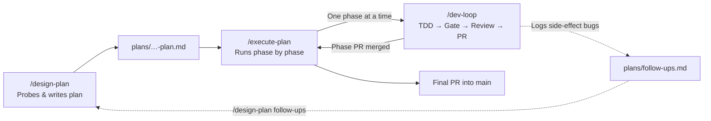
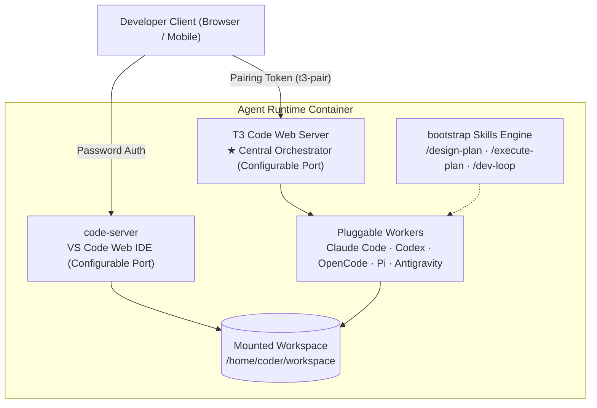

# Agentic Development Bootstrap

A complete starter kit, workflow engine, and runtime environment for building software autonomously with coding agents (Claude Code, Antigravity, OpenAI Codex, OpenCode, Pi, Cursor, and Copilot).

It gives you three things:

1. **A project scaffold** — One command sets up a new repository with an agent rulebook (`AGENTS.md`), pre-commit quality gate (`lefthook`), CI, and a `plans/` architecture structure.
2. **Three global skills** — `/design-plan`, `/execute-plan`, and `/dev-loop`, installed once per machine, that autonomously drive work from concept to reviewed PR.
3. **A turnkey agent container** — An isolated Docker runtime in `docker/` combining **T3 Code** (orchestrator), web-based VS Code (`code-server`), and configurable worker harnesses with skills pre-baked.

---

## Quick Start

### 1. Choose Your Environment

#### Option A: Local Machine (Install Once)
Installs skills into your local AI tools:

```bash
cd ~/dev/bootstrap
./install.sh
```
*The installer automatically detects your installed tools and registers the skills.*

#### Option B: Docker Agent Server (Isolated / Homelab)
Spins up a headless server with T3 Code and web-based VS Code:

```bash
cd ~/dev/bootstrap/docker
cp .env.example .env   # then set PASSWORD in .env
docker compose up -d
docker compose exec agent t3-pair
```
*Click the generated URL to open T3 Code on your laptop or phone.*

### 2. Scaffold a New Project

```bash
# Continuous release (apps, websites, games, microservices)
~/dev/bootstrap/init.sh ~/dev/my-app --type continuous

# Versioned release (libraries, compilers, packages with SemVer)
~/dev/bootstrap/init.sh ~/dev/my-lib --type versioned
```
*Existing files are preserved unless you pass `--force`.*

### 3. Configure the Quality Gate

1. Fill in every `[PLACEHOLDER]` in `AGENTS.md` and `.github/workflows/ci.yml`.
2. In `lefthook.yml`, specify your project's formatting, linting, and test commands (and mirror them under **Commands** in `AGENTS.md`).
3. Ensure [lefthook](https://github.com/evilmartians/lefthook) (`brew install lefthook` or `npm i -D lefthook && lefthook install`) and [gitleaks](https://github.com/gitleaks/gitleaks) 8.19+ are installed.

*The quality gate intentionally blocks commits until configured, preventing unverified code from slipping through.*

---

## How It Works

The three skills divide work into clean, accountable roles. Use `/dev-loop` alone for standalone fixes; chain all three for larger features.



| Skill | Purpose | Output |
| :--- | :--- | :--- |
| **`/design-plan`** | Complex features, refactors, architectural migrations | Verified gap audit, strict scope boundaries, small testable tasks |
| **`/execute-plan`** | Executing an approved plan phase-by-phase | One AI-reviewed PR per phase, followed by a final PR into `main` |
| **`/dev-loop`** | Bug fixes, isolated tasks, or single plan phases | TDD implementation, quality gate run, fresh AI review, clean PR |

> [!NOTE]
> Agents never commit on their own. Invoking `/dev-loop` or `/execute-plan` grants explicit permission to branch, commit, push, and open PRs according to the workflow rules.

---

### The Three Skills

#### 1. `/design-plan` — Probe Before You Build
Probes the codebase empirically to prove every claimed problem exists before drafting architecture. Defines what is in and out of scope, establishes done criteria, and splits work into atomic phases small enough for a single PR.
```text
/design-plan Add WebSocket reconnection with exponential backoff
/design-plan in gofront: Implement the encoding/csv stdlib package
/design-plan follow-ups plans/v1.8.0/portable-go-plan.md
```

#### 2. `/execute-plan` — Phase-by-Phase Orchestration
Operates on a dedicated `feat/<plan-slug>` branch. Runs subagents via `/dev-loop` for each phase, tracking progress by checking off plan task boxes (allowing interrupted runs to resume seamlessly). Pauses after each phase for human review, or uses `--auto` to merge clean phases automatically. Concludes with an independent whole-branch audit against the original plan.
```text
/execute-plan plans/v1.8.0/portable-go-plan.md
/execute-plan --auto plans/v1.8.0/portable-go-plan.md
```

#### 3. `/dev-loop` — From Failing Test to Reviewed PR
1. **TDD:** Writes a failing test first, then writes minimal code to pass.
2. **Quality Gate:** Executes the project's lefthook gate and drafts user-facing changelog notes.
3. **Draft PR:** Pushes branch and opens a draft pull request.
4. **Fresh-Context AI Review:** A fresh reviewer agent audits the diff. Critical findings receive one fix turn followed by a re-review.
5. **CI Gate:** Verifies remote CI status before marking the PR ready for merge.

#### Multi-Model Pairing
To eliminate blind spots, you can pair different models (e.g. Claude implements, Antigravity reviews):
```text
/dev-loop --pairing Fix race condition in session cleanup
/dev-loop --implementer=claude --reviewer=agy Fix race condition in session cleanup
```

> [!WARNING]
> During pairing, reviewer CLIs execute without interactive permission prompts. For full isolation, run paired workflows inside the Docker container.

---

## Docker Agent Server

For homelabs, remote servers, or sandboxed execution, `bootstrap` includes a turnkey container in [`docker/`](docker/):



### Quickstart

```bash
cd docker
cp .env.example .env   # then set PASSWORD in .env
docker compose up -d --build
docker compose exec agent t3-pair
```
Open the generated pairing link to access T3 Code, or open VS Code web in your browser at `http://localhost:${CODE_SERVER_HOST_PORT:-8080}`.

`PASSWORD` is required: the container gives VS Code a shell with passwordless sudo and access to your API keys, so `docker compose` refuses to start without one.

### Customizing Ports & Network Endpoints
Both web UIs listen on `127.0.0.1` only by default. All networking is configurable in `docker/.env`:
```bash
# Host ports & interface bindings
CODE_SERVER_HOST_PORT=8002       # Host port for VS Code web
T3_HOST_PORT=8011                # Host port for T3 Code
CODE_SERVER_BIND=0.0.0.0         # Expose VS Code web on the LAN (default 127.0.0.1)
T3_BIND=0.0.0.0                  # Expose T3 Code on the LAN (default 127.0.0.1)
T3_BASE_URL=http://my-host.lan:8011  # URL minted in t3-pair links
GIT_USER_NAME=Agent              # Author for commits agents make in the container
GIT_USER_EMAIL=agent@bootstrap.local
```

### Worker Management
Select which agent CLIs to enable via `docker/.env`:
```bash
ENABLED_WORKERS=claude,codex,opencode  # Available: claude, codex, opencode, pi, agy, all
```
* **Install dynamically:** `docker compose exec agent harness-install codex`
* **In-place live upgrade:** Run `./upgrade.sh` on the host (or `agent-upgrade` inside container) to update T3 Code, packages, and workers without resetting state.
* **Clean rebuild:** Run `./rebuild.sh` on the host for a cacheless build from scratch. The code-server base image is pinned; change `CODE_SERVER_VERSION` in `docker/Dockerfile` to move to a newer release.

---

## Workflow Principles

1. **`AGENTS.md` is the single source of truth:** Tool-specific files (`CLAUDE.md`, `.github/copilot-instructions.md`) only point to it. Cursor reads it directly.
2. **Plan before building:** Non-trivial work starts with a written, probed plan in `plans/`.
3. **Tool-independent quality gate:** The pre-commit hook and CI enforce standards identically regardless of who or what wrote the code.
4. **Zero git clutter:** Agent scratchpads, tool configurations, and local session caches are strictly gitignored.
5. **Write for the reader:** Documentation, READMEs, and changelogs are written plainly for humans. Plans are written for agents.

---

## Managing Plans & Follow-ups

All planning artifacts live exclusively in `plans/` (leaving `docs/` for human user guides):

```text
Versioned (Libraries / Compilers):       Continuous (Apps / Sites / Services):
plans/                                   plans/
  roadmap.md                               roadmap.md
  template.md                              template.md
  follow-ups.md                            follow-ups.md
  v1.0.0/                                  archive/
    auth-redesign-plan.md                    legacy-feature-plan.md
  v1.1.0/                                  active-feature-plan.md
    websocket-support-plan.md
```

- **`template.md`:** Canonical plan template with gap audits, scopes, and phased tasks.
- **`roadmap.md`:** Release roadmap (versioned) or Upcoming/Completed ledger (continuous).
- **`follow-ups.md`:** Out-of-scope bugs discovered during implementation. Resolved systematically via `/design-plan follow-ups`.

---

## Multi-Repo Rule Synchronization

Keep shared conventions synchronized across all your repositories using `sync.sh`:

```bash
./sync.sh             # Updates every sibling repo in ~/dev containing an AGENTS.md
./sync.sh --dry-run   # Preview changes without modifying files
./sync.sh --check     # Quality gate mode: exits 1 if any repository has drifted
./sync.sh ~/dev/app   # Target specific repositories
```

`sync.sh` propagates Part 1 of `scaffold/AGENTS.md`, bridge files, `plans/template.md`, and the managed block in `.gitignore` (delimited by `# >>> bootstrap-managed` and `# <<< bootstrap-managed`). Project-specific rules in Part 2 are never modified.

---

## Supported Tools & Harnesses

| Tool / CLI | Status | Skill Location | Notes |
| :--- | :--- | :--- | :--- |
| **Google Antigravity (`agy`)** | Supported | `~/.gemini/config/skills/` | Native subagent review |
| **Claude Code (`claude`)** | Supported | `~/.claude/skills/` & `/commands` | Native subagent review |
| **OpenAI Codex (`codex`)** | Supported | `~/.codex/skills/` | Supports pairing review |
| **OpenCode (`opencode`)** | Supported | `~/.config/opencode/skills/` | Local & remote models |
| **Pi (`pi`)** | Supported | `~/.pi/agent/skills/` | Minimalist terminal runner |
| **Cursor (`cursor`)** | Supported | `~/.cursor/rules/*.mdc` | Uses external CLI for review |
| **GitHub Copilot / VS Code (`code`)** | Supported | User prompt files (`.prompt.md`) | Prompts triggered via chat |

*Review requires a fresh-context reviewer: either the tool's native subagents, or a secondary installed CLI (`claude`, `agy`, or `codex`).*

---

## Repository Layout

```text
bootstrap/
├── docker/             Turnkey agent container (T3 Code, code-server, workers, upgrade scripts)
├── scaffold/           Template files copied into new projects by init.sh
├── skills/             The three universal AI skills (installed globally, never copied)
│   ├── design-plan/SKILL.md
│   ├── execute-plan/SKILL.md
│   └── dev-loop/SKILL.md
├── install.sh          Installs skills across detected AI tools on host
├── init.sh             Scaffolds a new project (--type continuous|versioned)
├── sync.sh             Synchronizes shared rules across projects (--check, --dry-run)
└── AGENTS.md           Agent guide for this repository
```
