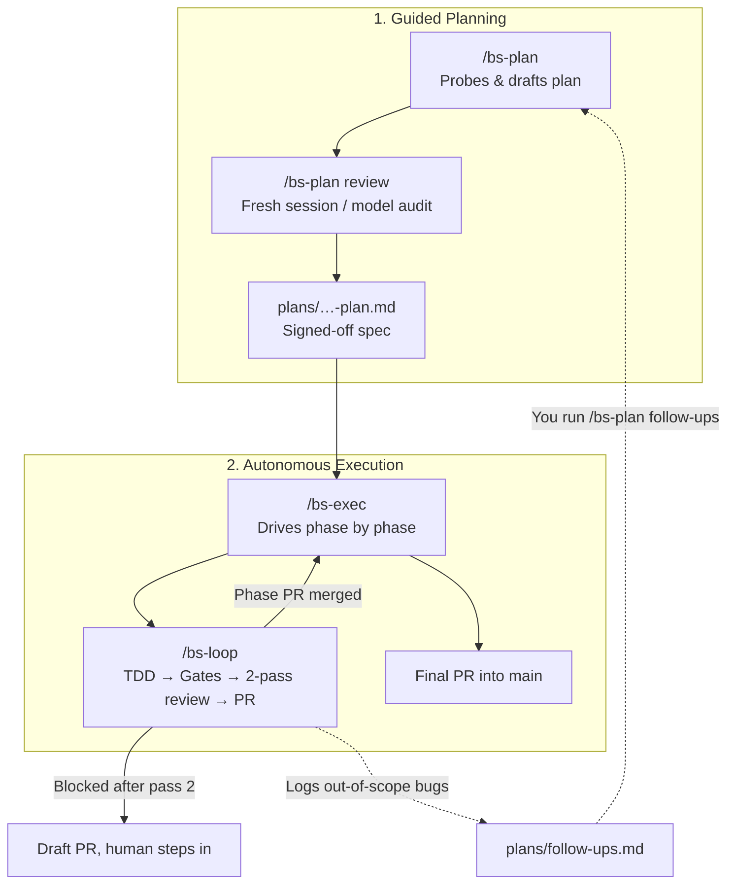

# Agentic Development Bootstrap

A complete starter kit, workflow engine, and runtime environment for building software autonomously with coding agents (Claude Code, Antigravity, OpenAI Codex, and Copilot).

It gives you three things:

1. **A project scaffold** — One command sets up a new repository with an agent rulebook (`AGENTS.md`), pre-commit quality gate (`lefthook`), CI, and a `plans/` architecture structure.
2. **Global `bs-*` skills** — `/bs-plan`, `/bs-exec`, and `/bs-loop` for full plan-to-PR automation, plus `/bs-probe`, `/bs-task`, and `/bs-review` for lightweight ad-hoc development, installed once per machine.
3. **A turnkey agent container** — An isolated Docker runtime in `docker/` combining **T3 Code** (orchestrator), web-based VS Code (`code-server`), and configurable worker harnesses with skills pre-baked.

---

## Quick Start

### 1. Choose Your Environment

#### Option A: Local Machine (Install Once)
Installs skills into your local AI tools:

```bash
cd ~/dev/bootstrap
./install.sh
```
*The installer automatically detects your installed tools and registers the skills. Installed skills are copies, so re-run `./install.sh` after pulling to update them; it also removes `bs-*` skills and helper scripts this repository no longer ships.*

#### Option B: Docker Agent Server (Isolated / Homelab)
Spins up a headless server with T3 Code and web-based VS Code:

```bash
cd ~/dev/bootstrap/docker
cp .env.example .env   # then set PASSWORD in .env
docker compose up -d
docker compose exec agent t3-pair
```
*Click the generated URL to open T3 Code on your laptop or phone.*

### 2. Scaffold a New Project

```bash
# Continuous release (apps, websites, games, microservices)
~/dev/bootstrap/init.sh ~/dev/my-app --type continuous

# Versioned release (libraries, compilers, packages with SemVer)
~/dev/bootstrap/init.sh ~/dev/my-lib --type versioned
```
*If any scaffold file already exists in the target, `init.sh` stops and lists them; pass `--force` to overwrite.*

### 3. Configure the Quality Gate

1. Fill in every `[PLACEHOLDER]` in `AGENTS.md` and `.github/workflows/ci.yml`, and adjust `.github/dependabot.yml` (remove the npm entry if the project does not use npm).
2. In `lefthook.yml`, specify your project's formatting, linting, and test commands (and mirror them under **Commands** in `AGENTS.md`). Leave the `extends: - lefthook-bootstrap.yml` line in place: that file holds the shared commit-message check and is kept up to date by `sync.sh`.
3. Ensure [lefthook](https://github.com/evilmartians/lefthook) (`brew install lefthook` or `npm i -D lefthook && lefthook install`) and [gitleaks](https://github.com/gitleaks/gitleaks) 8.19+ are installed.

*The quality gate intentionally blocks commits until configured, preventing unverified code from slipping through.*

---

## How the Agentic Workflow Works

The `bs-*` skills divide work into composable stages. For full features, `/bs-plan` is interactive, while `/bs-exec` and `/bs-loop` run autonomously until a PR is merged or a review gate blocks it. For ad-hoc local work without plans or PRs, use `/bs-probe`, `/bs-task`, and `/bs-review` directly.



| Skill | Role | Output |
| :--- | :--- | :--- |
| **`/bs-plan`** | Probe the codebase, define scope boundaries, and split work into small TDD phases (`review` audits a plan; `follow-ups` turns logged bugs you pick into fix phases) | Verified design plan in `plans/` |
| **`/bs-exec`** | Orchestrate an approved plan phase by phase on `feat/<plan-slug>`, then open the final merge PR | One reviewed, CI-verified PR per phase and a CI-verified final PR into `main` |
| **`/bs-loop`** | Implement a single phase or standalone task via T3 Code workers with TDD, quality gates, a PR, and 2-pass review (using `/bs-review` and `/bs-probe`) | Tested, AI-reviewed, CI-verified PR |
| **`/bs-task`** | Single-task local TDD implementation with root-cause checks and quality gates on the current branch (runs inline in any tool; no PR or review loop) | Verified local changes (optional safe commit) |
| **`/bs-review`** | Fresh-context, probe-verified AI code review via T3 Code for local diffs, branches, or PRs (supports `--pairing`; also drives `/bs-loop` Pass 1) | Review findings (`High`/`Medium`/`Low`/`Out of Scope`) |
| **`/bs-probe`** | Read-only root-cause investigation using `.probes/` and sibling-path checks (runs inline in any tool, or inside `/bs-plan`, `/bs-task`, `/bs-review`, and `/bs-loop`) | Root cause, minimal repro, and probe evidence |

> [!NOTE]
> Agents never commit on their own. Invoking `/bs-loop` or `/bs-exec` grants explicit permission to branch, commit, push, and open PRs according to the workflow rules.

### 1. `/bs-plan` — Probe Before You Build
Probes the codebase empirically to prove every claimed problem exists before drafting architecture. Defines what is in and out of scope, establishes falsifiable done criteria, and splits work into atomic phases small enough for a single PR. This is the human-in-the-loop stage: the skill stops and asks you on every scope or design trade-off, and you commit the plan before handing it to `/bs-exec`.
```text
/bs-plan Add WebSocket reconnection with exponential backoff
/bs-plan in gofront: Implement the encoding/csv stdlib package
/bs-plan review plans/v1.8.0/portable-go-plan.md       # Audit & tighten in a fresh session/model
/bs-plan follow-ups plans/v1.8.0/portable-go-plan.md   # Re-probe follow-ups, group by root cause, you pick what to schedule
```

### 2. `/bs-exec` — Phase-by-Phase Orchestration
Operates on a dedicated `feat/<plan-slug>` branch and runs `/bs-loop` for each phase, checking off `- [x] Task N.M` boxes as commits land so interrupted runs resume seamlessly. Pauses after each phase PR for human merge, or merges passing phases automatically with `--auto`. Every phase PR waits for CI like any other PR. If a phase PR is blocked by the review or CI gate, it halts (even with `--auto`), leaves the PR in Draft, and alerts you to step in. Start it on a clean working tree: re-running `/bs-exec` (or `/bs-loop`) after an interrupted review picks the review up where it stopped, and if you have uncommitted files it stops and lists them instead of touching them. In a fresh worktree, such as a T3 Code thread, it installs the project's locked dependencies before the first commit. Once all phases pass, it merges in whatever landed on the base branch meanwhile (keeping both sides when several plans added follow-ups or changelog entries), runs the full gate, marks the plan complete, and opens the final PR into the base branch.
```text
/bs-exec plans/v1.8.0/portable-go-plan.md
/bs-exec --auto plans/v1.8.0/portable-go-plan.md
```

### 3. `/bs-loop` — From Failing Test to Reviewed PR
1. **TDD Implementation (T3 Code `Implementer` & `/bs-probe`):** Dispatches a fresh T3 Code worker for the standalone task or each `Task N.M` in a plan phase (using `/bs-probe` to isolate root causes and check sibling paths), writing a failing test first and the minimal implementation to pass.
2. **Quality Gate & Docs:** Runs the project's full gate (format, lint, and tests) and updates `CHANGELOG.md` / user docs when behavior changed. The orchestrator re-runs the full test suite only when the implementer's own run failed or tested a different commit; reviewers run lint, the affected tests, and their probes.
3. **Draft PR:** Pushes the branch and opens a draft PR once the gate has passed.
4. **2-Pass Fresh AI Review (`/bs-review` & `/bs-probe`):** Pass 1 runs `/bs-review` in a fresh reviewer context with active `/bs-probe` verification in `.probes/`. High/Medium findings get at most one fix turn, after which a *new* fresh reviewer verifies the fixes. Pass 2 is terminal: `LGTM` passes the gate; anything unresolved leaves the PR in Draft as `BLOCKED_BY_DEFECTS` for you to investigate, or you can tell the orchestrator to fix it on the PR's branch, which grants one more fix turn and a new fresh review. Out-of-scope bugs, unfixed behavioral nits, and unrelated pre-existing bugs are automatically logged to `plans/follow-ups.md` with a repro instead of pausing the run. They stay there until you run `/bs-plan follow-ups`, which re-probes them, groups them by root cause, and asks you which groups to schedule, defer, or drop. Even under `--auto`, you are still asked before a change that loosens a check (a lint exclude, a re-saved quality baseline) is kept, and before a newly introduced or blocking bug is left for later when a later phase depends on it, it forced a test to be dropped, or the final review found it in new code the first review missed.
5. **CI Gate:** Waits for remote CI checks before marking the PR ready, for standalone tasks and plan phases alike. If every check was skipped, the PR says CI did not test it instead of claiming a pass, and a PR that conflicts with its base branch stays in Draft.

### 4. Ad-Hoc Local Workflow (`/bs-probe`, `/bs-task`, `/bs-review`)
Use these when you want fast, local iteration without design plans, Draft PRs, or automated fix loops:
```text
/bs-probe Why does config merge drop nested overrides?
/bs-task Fix nested config merge in loader.go
/bs-review                    # Branch commits + uncommitted changes
/bs-review #42                # A pull request
/bs-review main...feat/x      # A branch range
/bs-review --pairing          # Review with a different tool
```

You don't need a clean working tree for these. `/bs-task` works on your current branch next to your own uncommitted edits: it commits only when you ask, commits only its own files, won't commit a file you were already editing, and tells you when its checks ran with your edits present or changed any of your files. `/bs-review` covers your uncommitted changes too, and if your working tree changes during the review, it warns you, shows `git status`, and leaves everything as it is.

### Multi-Model Pairing
Pair different model families so the reviewer doesn't share the implementer's blind spots. `--pairing` keeps the tool you are in as implementer and picks the first other available tool (Claude Code, Antigravity, then Codex) as reviewer; `--implementer` and `--reviewer` name them explicitly. A paired tool runs on a default model (`claude-sonnet-5-5` for Claude, `gemini-4-hydrogen` for Antigravity, `gpt-6.1-terra` for Codex) unless you pass `--implementer-model` or `--reviewer-model`:
```text
/bs-loop --pairing Fix race condition in session cleanup
/bs-loop --implementer=claude --reviewer=agy --reviewer-model=gemini-4-hydrogen Fix race condition in session cleanup
/bs-exec --auto --pairing plans/v1.8.0/portable-go-plan.md
```

- The defaults are configured in `workflows/shared/models.env`, alongside stronger fix-escalation models for the review fix turn (`claude-opus-5-5`, `gemini-4-neon`, `gpt-6.2-sol`). To change or disable one without modifying this repo, set it in `${XDG_CONFIG_HOME:-~/.config}/bootstrap/models.env` and re-run `./install.sh`; names you leave out keep the repo default:
  ```sh
  BS_MODEL_AGY="<model-id>"     # also BS_MODEL_CLAUDE, BS_MODEL_CODEX
  BS_FIX_MODEL_CLAUDE=""        # empty disables fix-turn escalation (also BS_FIX_MODEL_AGY, BS_FIX_MODEL_CODEX)
  ```
  The paired defaults are deliberately mid-tier models rather than each provider's most capable one: plans split the work into small phases, so each diff is small enough for them to handle well, which keeps paired runs fast and cheap. They apply only to the paired tool; the tool you are in keeps your session's model. Pass a model flag for a stronger model on large or risky changes.
- Orchestrated workflows (`/bs-exec`, `/bs-loop`, `/bs-review`) run through **T3 Code (`delegate_task`)** (for example inside the Docker agent server below), so every implementer, fixer, and reviewer runs as a live child thread with explicit model and reasoning effort. Running `/bs-review` outside T3 Code reports `PENDING_REVIEW`, and `/bs-loop`/`/bs-exec` stop and direct you to `/bs-task` or `/bs-probe` for local inline work.
- A model or provider is never swapped silently: if one you asked for, or a paired default, is unavailable, that role stops and tells you (an unavailable automatic fix-escalation model announces a fallback to the normal model via `delegate_task`).
- Without `--implementer-model`, the fix turn escalates to the provider's `BS_FIX_MODEL_*` when configured (unless the session is already on that model), falling back to the normal model with a note in chat if it is unavailable.

---

## Managing Plans, Rules & Multi-Repo Sync

All planning artifacts for agents live in `plans/`, keeping `docs/`, `README.md`, and `CHANGELOG.md` strictly for human readers:

```text
Versioned (Libraries / Compilers):       Continuous (Apps / Sites / Services):
plans/                                   plans/
  roadmap.md                               roadmap.md
  template.md                              template.md
  follow-ups.md                            follow-ups.md
  v1.0.0/                                  archive/
    auth-redesign-plan.md                    completed-feature-plan.md
  v1.1.0/                                  active-feature-plan.md
    websocket-support-plan.md
```

- **`AGENTS.md` is the single source of truth:** Part 1 holds universal workflow rules; Part 2 holds project commands and architecture. Tool bridge files (`CLAUDE.md`, `.github/copilot-instructions.md`) simply point to it.
- **Keep every repository in sync with `sync.sh`:**
  ```bash
  ./sync.sh             # Syncs every sibling repo in ~/dev containing an AGENTS.md
  ./sync.sh --dry-run   # Preview changes without modifying files
  ./sync.sh --check     # Quality gate mode: exits 1 if any repository has drifted
  ./sync.sh ~/dev/app   # Target specific repositories
  ```
  `sync.sh` propagates `scaffold/AGENTS.md` Part 1, bridge files, `plans/template.md`, `lefthook-bootstrap.yml`, and the `# >>> bootstrap-managed` `.gitignore` block without touching project-specific Part 2 rules or your `lefthook.yml`. It also reports, without editing, a CI workflow `if:` that still skips plan phase PRs. A repository whose `AGENTS.md` has no Part 1 (a third-party clone, for example) is reported and left untouched.

---

## Supported Tools & Harnesses

| Tool / CLI | Skill Location | Orchestrated Roles (`/bs-exec`, `/bs-loop`, `/bs-review`) |
| :--- | :--- | :--- |
| **Google Antigravity (`agy`)** | `~/.gemini/config/skills/` | T3 Code (`delegate_task`) worker & orchestrator |
| **Claude Code (`claude`)** | `~/.claude/skills/` & `~/.claude/commands/` | T3 Code (`delegate_task`) worker & orchestrator |
| **OpenAI Codex (`codex`)** | `~/.codex/skills/` | T3 Code (`delegate_task`) worker & orchestrator |
| **GitHub Copilot / VS Code (`code`)** | User prompt files (`.prompt.md`) | Local inline skills (`/bs-plan`, `/bs-task`, `/bs-probe`) |

---

## Docker Agent Server (`docker/`)

For homelabs, remote servers, or sandboxed execution, `docker/` provides an isolated container running **T3 Code** (orchestrator), **code-server** (VS Code in the browser), and configurable worker harnesses (`claude`, `codex`, `agy`) with the bootstrap skills pre-installed.

- **Security:** Both web UIs bind to `127.0.0.1` by default, and `docker compose` requires `PASSWORD` to be set in `docker/.env` before starting. The container itself also refuses to start without `PASSWORD` (or `HASHED_PASSWORD`) unless you set `CODE_SERVER_AUTH=none`.
- **Networking & Workers (`docker/.env`):**
  ```bash
  CODE_SERVER_HOST_PORT=8002           # Host port for VS Code web (default 8080)
  T3_HOST_PORT=8012                    # Host port for T3 Code (default 8011)
  CODE_SERVER_BIND=0.0.0.0             # Expose on LAN (default 127.0.0.1)
  T3_BIND=0.0.0.0                      # Expose on LAN (default 127.0.0.1)
  T3_BASE_URL=http://my-host.lan:8012  # URL minted in t3-pair links
  ENABLED_WORKERS=claude,codex,agy     # Available: claude, codex, agy, all (an unknown name fails the build)
  ```
- **Maintenance:** Install a worker dynamically with `docker compose exec agent harness-install codex`, upgrade in-place with `./upgrade.sh` (or `agent-upgrade` inside the container), or rebuild from scratch with `./rebuild.sh`.

---

## Repository Layout

```text
bootstrap/
├── docker/             Turnkey agent container (T3 Code, code-server, workers, upgrade scripts)
├── scaffold/           Template files copied into new projects by init.sh
├── workflows/          Everything install.sh deploys machine-wide
│   ├── skills/         Universal AI skills (rendered by install.sh into each detected tool)
│   │   ├── bs-plan/SKILL.md
│   │   ├── bs-exec/SKILL.md
│   │   ├── bs-loop/SKILL.md
│   │   ├── bs-task/SKILL.md
│   │   ├── bs-review/SKILL.md
│   │   └── bs-probe/SKILL.md
│   └── shared/         Shared docs and scripts, installed to ${XDG_DATA_HOME:-~/.local/share}/bootstrap/
│       ├── conventions-core.md    Core worker conventions (terms, probes, people docs, follow-ups)
│       ├── conventions-writer.md  Writer-only rules (implementation, gate runs, safe commit)
│       ├── dispatch.md            Orchestrator states, T3 Code dispatch, verify, and CI rules
│       ├── recovery.md            On-demand resume, user-granted fix turn, and docs-only fast path
│       ├── role-*.md              Short briefs for each worker role (implementer, defect fixer, reviewer, fix verifier)
│       ├── scripts/               Helpers the skills call to check the tree, commit safely, run/time gate commands, check review replies, resolve T3 Code role routing/models, verify worker commits/gates, pick the diff to review, check out temporary worktrees, set up plan branches, write the PR review gate and triage state, and read plan, drift, PR, and CI state
│       └── models.env             Default paired and fix-escalation model names, filled in at install (override in ${XDG_CONFIG_HOME:-~/.config}/bootstrap/models.env)
├── install.sh          Installs skills, shared docs, and helper scripts across detected AI tools
├── init.sh             Scaffolds a new project (--type continuous|versioned)
├── sync.sh / sync.py   Synchronizes shared rules across projects (--check, --dry-run)
├── tests/smoke.sh      Smoke test for init.sh, sync.sh, and install.sh (runs in a temp dir)
├── tests/scripts.sh    Tests for the helper scripts (runs against throwaway repos and a fake gh in a temp dir)
├── tests/lint.sh       Syntax and ShellCheck lint over every shell and Python script (CI runs it with both test suites)
├── .github/workflows/  CI for this repository
└── AGENTS.md           Agent guide for this repository
```
