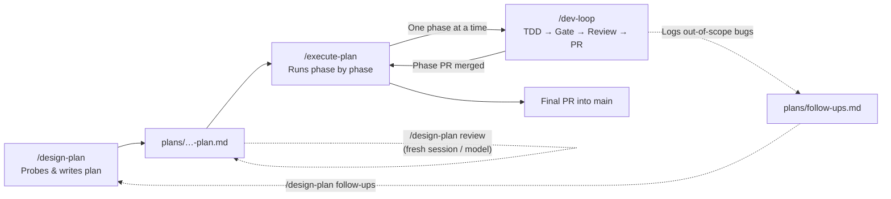

# Agentic Development Bootstrap

A complete starter kit, workflow engine, and runtime environment for building software autonomously with coding agents (Claude Code, Antigravity, OpenAI Codex, OpenCode, Pi, Cursor, and Copilot).

It gives you three things:

1. **A project scaffold** — One command sets up a new repository with an agent rulebook (`AGENTS.md`), pre-commit quality gate (`lefthook`), CI, and a `plans/` architecture structure.
2. **Three global skills** — `/design-plan`, `/execute-plan`, and `/dev-loop`, installed once per machine, that autonomously drive work from concept to reviewed PR.
3. **A turnkey agent container** — An isolated Docker runtime in `docker/` combining **T3 Code** (orchestrator), web-based VS Code (`code-server`), and configurable worker harnesses with skills pre-baked.

---

## Quick Start

### 1. Choose Your Environment

#### Option A: Local Machine (Install Once)
Installs skills into your local AI tools:

```bash
cd ~/dev/bootstrap
./install.sh
```
*The installer automatically detects your installed tools and registers the skills.*

#### Option B: Docker Agent Server (Isolated / Homelab)
Spins up a headless server with T3 Code and web-based VS Code:

```bash
cd ~/dev/bootstrap/docker
cp .env.example .env   # then set PASSWORD in .env
docker compose up -d
docker compose exec agent t3-pair
```
*Click the generated URL to open T3 Code on your laptop or phone.*

### 2. Scaffold a New Project

```bash
# Continuous release (apps, websites, games, microservices)
~/dev/bootstrap/init.sh ~/dev/my-app --type continuous

# Versioned release (libraries, compilers, packages with SemVer)
~/dev/bootstrap/init.sh ~/dev/my-lib --type versioned
```
*Existing files are preserved unless you pass `--force`.*

### 3. Configure the Quality Gate

1. Fill in every `[PLACEHOLDER]` in `AGENTS.md` and `.github/workflows/ci.yml`.
2. In `lefthook.yml`, specify your project's formatting, linting, and test commands (and mirror them under **Commands** in `AGENTS.md`). Leave the `extends: - lefthook-bootstrap.yml` line in place: that file holds the shared commit-message check and is kept up to date by `sync.sh`.
3. Ensure [lefthook](https://github.com/evilmartians/lefthook) (`brew install lefthook` or `npm i -D lefthook && lefthook install`) and [gitleaks](https://github.com/gitleaks/gitleaks) 8.19+ are installed.

*The quality gate intentionally blocks commits until configured, preventing unverified code from slipping through.*

---

## How the Agentic Workflow Works

The three skills divide work into clean, accountable stages. Use `/dev-loop` alone for standalone fixes; chain all three for larger features.



| Skill | Role | Output |
| :--- | :--- | :--- |
| **`/design-plan`** | Probe the codebase, define scope boundaries, and split work into small TDD phases (`review` audits a plan; `follow-ups` schedules logged bugs) | Verified design plan in `plans/` |
| **`/execute-plan`** | Orchestrate an approved plan phase by phase on `feat/<plan-slug>`, then audit the full branch | One reviewed PR per phase + final PR into `main` |
| **`/dev-loop`** | Implement a single phase or standalone task via TDD, quality gates, and 2-pass fresh AI review | Tested, AI-reviewed, CI-verified PR |

> [!NOTE]
> Agents never commit on their own. Invoking `/dev-loop` or `/execute-plan` grants explicit permission to branch, commit, push, and open PRs according to the workflow rules.

### 1. `/design-plan` — Probe Before You Build
Probes the codebase empirically to prove every claimed problem exists before drafting architecture. Defines what is in and out of scope, establishes falsifiable done criteria, and splits work into atomic phases small enough for a single PR.
```text
/design-plan Add WebSocket reconnection with exponential backoff
/design-plan in gofront: Implement the encoding/csv stdlib package
/design-plan review plans/v1.8.0/portable-go-plan.md       # Audit & tighten in a fresh session/model
/design-plan follow-ups plans/v1.8.0/portable-go-plan.md   # Turn follow-ups.md into fix phases
```

### 2. `/execute-plan` — Phase-by-Phase Orchestration
Operates on a dedicated `feat/<plan-slug>` branch and runs `/dev-loop` for each phase, checking off `- [x] Task N.M` boxes as commits land so interrupted runs resume seamlessly. Pauses after each phase PR for human merge, or merges passing phases automatically with `--auto`. Finishes with follow-up triage, release-note polishing, and a full-branch audit against the plan.
```text
/execute-plan plans/v1.8.0/portable-go-plan.md
/execute-plan --auto plans/v1.8.0/portable-go-plan.md
```

### 3. `/dev-loop` — From Failing Test to Reviewed PR
1. **TDD:** Writes a failing test first, then the minimal implementation to pass.
2. **Quality Gate & Docs:** Runs the project's pre-commit gate and updates `CHANGELOG.md` / user docs when behavior changed.
3. **Draft PR:** Pushes the branch and opens a draft PR.
4. **2-Pass Fresh AI Review:** A fresh reviewer agent audits the diff with active `.probes/` checks (max 2 review passes, max 1 fix turn; out-of-scope bugs are logged to `plans/follow-ups.md`).
5. **CI Gate:** Waits for remote CI checks before marking the PR ready.

### Multi-Model Pairing
Pair different model families so the reviewer doesn't share the implementer's blind spots:
```text
/dev-loop --pairing Fix race condition in session cleanup
/dev-loop --implementer=claude --reviewer=agy Fix race condition in session cleanup
/execute-plan --auto --pairing plans/v1.8.0/portable-go-plan.md
```

> [!WARNING]
> During pairing, headless reviewer CLIs run without interactive permission prompts. For full isolation, run paired workflows inside the Docker container.

---

## Managing Plans, Rules & Multi-Repo Sync

All planning artifacts for agents live in `plans/`, keeping `docs/`, `README.md`, and `CHANGELOG.md` strictly for human readers:

```text
Versioned (Libraries / Compilers):       Continuous (Apps / Sites / Services):
plans/                                   plans/
  roadmap.md                               roadmap.md
  template.md                              template.md
  follow-ups.md                            follow-ups.md
  v1.0.0/                                  archive/
    auth-redesign-plan.md                    completed-feature-plan.md
  v1.1.0/                                  active-feature-plan.md
    websocket-support-plan.md
```

- **`AGENTS.md` is the single source of truth:** Part 1 holds universal workflow rules; Part 2 holds project commands and architecture. Tool bridge files (`CLAUDE.md`, `.github/copilot-instructions.md`) simply point to it, and Cursor reads it natively.
- **Keep every repository in sync with `sync.sh`:**
  ```bash
  ./sync.sh             # Syncs every sibling repo in ~/dev containing an AGENTS.md
  ./sync.sh --dry-run   # Preview changes without modifying files
  ./sync.sh --check     # Quality gate mode: exits 1 if any repository has drifted
  ./sync.sh ~/dev/app   # Target specific repositories
  ```
  `sync.sh` propagates `scaffold/AGENTS.md` Part 1, bridge files, `plans/template.md`, `lefthook-bootstrap.yml`, and the `# >>> bootstrap-managed` `.gitignore` block without touching project-specific Part 2 rules or your `lefthook.yml`.

---

## Supported Tools & Harnesses

| Tool / CLI | Skill Location | Review Mode |
| :--- | :--- | :--- |
| **Google Antigravity (`agy`)** | `~/.gemini/config/skills/` | Native subagents + CLI pairing |
| **Claude Code (`claude`)** | `~/.claude/skills/` & `/commands` | Native subagents + CLI pairing |
| **OpenAI Codex (`codex`)** | `~/.codex/skills/` | Native subagents + CLI pairing |
| **OpenCode (`opencode`)** | `~/.config/opencode/skills/` | Paired CLI review |
| **Pi (`pi`)** | `~/.pi/agent/skills/` | Paired CLI review |
| **Cursor (`cursor`)** | `~/.cursor/rules/*.mdc` | Paired CLI review |
| **GitHub Copilot / VS Code (`code`)** | User prompt files (`.prompt.md`) | Paired CLI review |

---

## Docker Agent Server (`docker/`)

For homelabs, remote servers, or sandboxed execution, `docker/` provides an isolated container running **T3 Code** (orchestrator), **code-server** (VS Code in the browser), and configurable worker harnesses (`claude`, `codex`, `opencode`, `pi`, `agy`) with the bootstrap skills pre-installed.

- **Security:** Both web UIs bind to `127.0.0.1` by default, and `docker compose` requires `PASSWORD` to be set in `docker/.env` before starting.
- **Networking & Workers (`docker/.env`):**
  ```bash
  CODE_SERVER_HOST_PORT=8002           # Host port for VS Code web (default 8080)
  T3_HOST_PORT=8011                    # Host port for T3 Code (default 3773)
  CODE_SERVER_BIND=0.0.0.0             # Expose on LAN (default 127.0.0.1)
  T3_BIND=0.0.0.0                      # Expose on LAN (default 127.0.0.1)
  T3_BASE_URL=http://my-host.lan:8011  # URL minted in t3-pair links
  ENABLED_WORKERS=claude,codex,agy     # Available: claude, codex, opencode, pi, agy, all
  ```
- **Maintenance:** Install a worker dynamically with `docker compose exec agent harness-install codex`, upgrade in-place with `./upgrade.sh` (or `agent-upgrade` inside the container), or rebuild from scratch with `./rebuild.sh`.

---

## Repository Layout

```text
bootstrap/
├── docker/             Turnkey agent container (T3 Code, code-server, workers, upgrade scripts)
├── scaffold/           Template files copied into new projects by init.sh
├── skills/             The three universal AI skills (installed globally, never copied)
│   ├── design-plan/SKILL.md
│   ├── execute-plan/SKILL.md
│   └── dev-loop/SKILL.md
├── install.sh          Installs skills across detected AI tools on host
├── init.sh             Scaffolds a new project (--type continuous|versioned)
├── sync.sh             Synchronizes shared rules across projects (--check, --dry-run)
└── AGENTS.md           Agent guide for this repository
```
