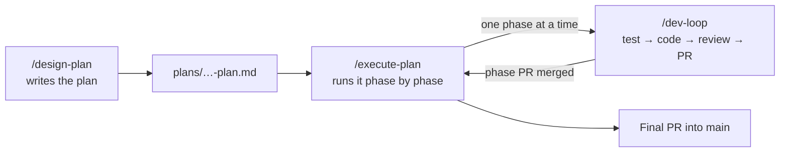

# Agentic Development Bootstrap

A starter kit and a set of AI workflows for building software with coding agents (Claude Code, Antigravity, Codex, Cursor, Copilot).

It gives you two things:

- **A project scaffold** — one command sets up a new repository with an agent rulebook (`AGENTS.md`), a pre-commit quality gate, CI, and a `plans/` folder for design docs.
- **Three global skills** — `/design-plan`, `/execute-plan`, and `/dev-loop`, installed once per machine, that take work from idea to reviewed pull request.

## Quick Start

**1. Install the skills (once per machine).**

```bash
cd ~/dev/bootstrap
./install.sh
```

The installer detects which AI tools you have and installs the skills only for those.

**2. Scaffold a project.**

```bash
# Apps, sites, games, services (default)
~/dev/bootstrap/init.sh ~/dev/my-app --type continuous

# Libraries, compilers, anything with release versions
~/dev/bootstrap/init.sh ~/dev/my-lib --type versioned
```

Existing files are never overwritten unless you pass `--force`.

**3. Configure the quality gate.**

- Fill in every `[PLACEHOLDER]` in `AGENTS.md` and `.github/workflows/ci.yml`.
- In `lefthook.yml`, replace the placeholder commands with your real format, lint, and test commands, and list the same commands under **Commands** in `AGENTS.md`. The skills run those commands as their quality gate.
- Install [lefthook](https://github.com/evilmartians/lefthook) (`brew install lefthook` or `npm install --save-dev lefthook`, then `lefthook install`) and [gitleaks](https://github.com/gitleaks/gitleaks#installing) 8.19 or newer for the secret scan.

The gate fails until it is configured, so an unconfigured project can't pass by accident. CI runs the same gate, so the commands only live in `lefthook.yml`.

## How It Works

The skills split work into three roles. Use `/dev-loop` alone for small tasks; use all three for larger features.



| Skill | Use it for | What you get |
| :--- | :--- | :--- |
| `/design-plan` | Features that touch several parts of the code, migrations, risky changes | A design plan with verified gaps, a clear scope, and small testable tasks |
| `/execute-plan` | Carrying out an approved plan | One reviewed PR per phase, then a final PR into `main` |
| `/dev-loop` | Bug fixes and standalone tasks (and each phase of a plan) | A tested, AI-reviewed PR that is marked ready only when review and CI are clean |

Agents never commit on their own. Running `/dev-loop` or `/execute-plan` counts as permission to branch, commit, push, and open PRs as that workflow describes.

### `/design-plan` — plan before you build

Before writing a plan, it probes the codebase to prove every problem it claims exists, so the plan isn't built on guesses. The plan lists what is in and out of scope (with reasons), states how "done" will be checked, and splits the work into phases small enough for one reviewed PR each. The plan is linked from `plans/roadmap.md`. Commit the plan and roadmap before running `/execute-plan`, which won't start with uncommitted changes.

`/design-plan follow-ups` turns the open bugs in `plans/follow-ups.md` into fix phases.

```text
/design-plan Add WebSocket reconnection with exponential backoff
/design-plan in gofront: Implement the encoding/csv stdlib package
/design-plan follow-ups plans/v1.8.0/portable-go-plan.md
```

### `/execute-plan` — run the plan

Works on a branch named `feat/<plan-slug>` and handles one phase at a time: a subagent implements the phase with `/dev-loop` on its own branch, then the phase PR is reviewed. Progress is tracked by ticking the plan's checkboxes, so an interrupted run picks up where it stopped.

By default it pauses after each phase for you to merge. With `--auto` it merges passing phases itself and keeps going. When all tasks are done, it checks the follow-up list, has a fresh agent turn the plan's changelog entries into readable release notes, has another fresh agent audit the whole branch against the plan, and opens the final PR into `main`.

```text
/execute-plan plans/v1.8.0/portable-go-plan.md
/execute-plan --auto plans/v1.8.0/portable-go-plan.md
```

### `/dev-loop` — from failing test to ready PR

1. Writes a failing test, then the code to make it pass.
2. Runs the project's quality gate and writes a changelog entry for the people using the project (not a list of what the code does).
3. Opens a draft PR.
4. A fresh AI reviewer (never the agent that wrote the code) checks it, including whether the changelog and docs make sense to a user. Serious findings get one fix round, followed by a second and final review.
5. Waits for CI, and marks the PR ready only if review and CI are both clean. Otherwise the PR stays a draft with the findings in its description.

Bugs the reviewer spots outside the change are logged in `plans/follow-ups.md` instead of being fixed on the side.

```text
/dev-loop Fix the race condition in session cleanup
/dev-loop in gofront: Add a benchmark for AST token parsing
```

Each skill's full, step-by-step rules live in its `SKILL.md` under [`skills/`](skills/).

## Principles

1. **`AGENTS.md` is the single source of truth.** Tool-specific files (`CLAUDE.md`, `.github/copilot-instructions.md`) only point to it. Cursor reads it directly.
2. **Plan first.** Non-trivial work starts with a written plan in `plans/`, which stays as the record of *why* the code looks the way it does.
3. **The gate is independent of the tool.** The pre-commit hook and CI block bad commits no matter which agent (or person) wrote the code.
4. **No session clutter in git.** Agent scratchpads and tool session state are ignored.
5. **Write for the reader.** `README.md`, `docs/`, and `CHANGELOG.md` are written for people: short and plain, with no task IDs or file paths. Plans in `plans/` are written for agents and can be as dense as they need to be.

## Plans and Follow-ups

Everything the skills read and write lives in `plans/`. The `docs/` folder is left for documentation written for people.

```text
Versioned (library / compiler):          Continuous (app / game / site):
plans/                                   plans/
  roadmap.md                               roadmap.md
  template.md                              template.md
  follow-ups.md                            follow-ups.md
  v0.2.0/                                  archive/
    auth-redesign-plan.md                    old-feature-plan.md
  v0.3.0/                                  active-feature-plan.md
    websocket-support-plan.md
```

- **`template.md`** is the starting point for new plans.
- **`roadmap.md`** lists plans by release (versioned) or as Upcoming/Completed tables (continuous).
- **`follow-ups.md`** collects bugs noticed outside the current task, each with a way to reproduce it. `/design-plan follow-ups` schedules them, so the list only holds open bugs.

**Versioned vs. continuous.** Versioned projects group plans by release (`plans/vX.Y.Z/`) and use SemVer changelog sections. Continuous projects keep active plans directly in `plans/`, use `## [Unreleased]` or calendar sections (`## [YYYY-MM]`) in the changelog, and move finished plans to `plans/archive/`.

## Keeping Projects in Sync

Shared rules are edited here, then pushed to your other projects:

```bash
./sync.sh             # update every sibling project in ~/dev that has an AGENTS.md
./sync.sh --dry-run   # preview changes
./sync.sh --check     # exit 1 if any project has drifted
./sync.sh ~/dev/app   # sync specific projects only
```

`sync.sh` copies Part 1 of `scaffold/AGENTS.md`, the bridge files, `plans/template.md`, and the shared `.gitignore` block (between the `# >>> bootstrap-managed` and `# <<< bootstrap-managed` markers). Part 2 of each project's `AGENTS.md` and any ignores outside the markers are never touched.

To ignore a new tool's session folder everywhere, add it to `scaffold/.gitignore` here and run `./sync.sh`.

## Supported Tools

| Tool | Status | Installed to |
|---|---|---|
| Google Antigravity (`agy`) | Tested | `~/.gemini/config/skills/` |
| Claude Code (`claude`) | Tested | `~/.claude/skills/` and `~/.claude/commands/` |
| OpenAI Codex (`codex`) | Installed, untested | `~/.codex/skills/` |
| Cursor (`cursor`) | Installed, untested | `~/.cursor/rules/*.mdc` |
| GitHub Copilot / VS Code (`code`) | Installed, untested | User prompt files (`.prompt.md`) |

The review steps depend on the tool being able to start a fresh-context subagent. If it can't, implementation still runs but review halts: the PR stays a draft marked `REVIEW_STATUS=PENDING_REVIEW` rather than letting the agent review its own work.

## Repository Layout

```text
bootstrap/
├── install.sh          Installs the skills for the AI tools on this machine
├── init.sh             Scaffolds a new project (--type continuous|versioned, --force)
├── sync.sh             Pushes shared rules to sibling projects (--check, --dry-run)
├── AGENTS.md           Agent guide for this repo (Part 1 synced from scaffold/AGENTS.md)
├── skills/             The three skills; installed globally, never copied into projects
│   ├── design-plan/SKILL.md
│   ├── execute-plan/SKILL.md
│   └── dev-loop/SKILL.md
└── scaffold/           Copied into new projects by init.sh
    ├── AGENTS.md                         Rules (Part 1) + project context to fill in (Part 2)
    ├── CLAUDE.md                         Points to AGENTS.md; don't edit
    ├── .github/copilot-instructions.md   Points to AGENTS.md; don't edit
    ├── .github/workflows/ci.yml          Runs the lefthook gate on every PR and on main/feat/** pushes
    ├── .github/dependabot.yml            Monthly dependency and Actions updates
    ├── lefthook.yml                      Gate: format → lint → test, secret scan, commit message check
    ├── .gitignore                        Common ignores + the bootstrap-managed block
    ├── plans/                            template.md and an empty follow-ups.md
    └── templates/                        CHANGELOG.md and roadmap.md per release model
        ├── continuous/
        └── versioned/
```
