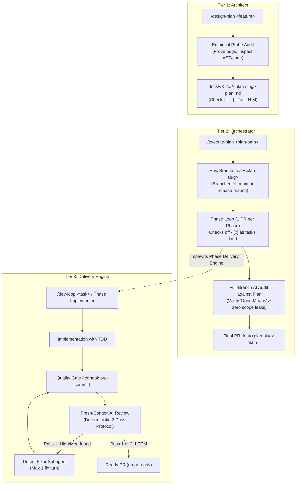
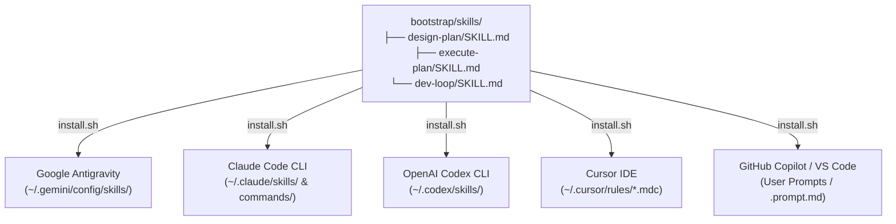

# Agentic Development Workflows & Skills Architecture

This document describes the design, operational lifecycle, and interaction model of the autonomous AI skills bundled with the **Agentic Development Bootstrap**.

---

## 1. Executive Summary: The 3-Tier Lifecycle

Autonomous AI development works best when responsibilities are separated into distinct operational tiers:



| Tier | Skill | Role | When to Use | Output |
| :--- | :--- | :--- | :--- | :--- |
| **1. Architect** | [`/design-plan`](#1-design-plan-the-architect) | **Pre-implementation** | Complex features, architectural migrations, multi-component refactors | Exhaustive plan document (`docs/vX.Y.Z/<plan-slug>-plan.md`) with probe evidence & task checklist |
| **2. Orchestrator** | [`/execute-plan`](#2-execute-plan-the-orchestrator) | **Multi-phase execution** | Once a design plan is approved | Creates epic branch, coordinates phased PRs, updates `- [x]`, conducts pre-merge branch audit |
| **3. Delivery Unit** | [`/dev-loop`](#3-dev-loop-the-delivery-engine) | **Single-task execution** | Targeted bugfixes, standalone tasks, or driven by `/execute-plan` | Feature branch, TDD, quality gate, draft PR, isolated AI review & fix, published PR |

---

## 2. Detailed Breakdown of Skills

### 1. `/design-plan` (The Architect)

**Purpose:** Prevents shallow, hallucinated planning by forcing an active empirical audit of the codebase before writing design text.

#### Operational Flow:
1. **Target Discovery:** Resolves target repository (supporting multi-repo umbrella workspaces like `~/dev`).
2. **Empirical Codebase Audit (No Guessing):**
   - The agent writes and executes small, non-destructive test probes or CLI commands to verify baseline behavior.
   - Verifies existing limitations, missing types, or silent wrong results.
   - Formulates the **Verified Gaps & Baseline Audit** table with exact file/line citations and probe evidence.
3. **Boundary & Scope Definition:**
   - Defines explicit categories: `In scope: core`, `In scope: target-specific`, `Excluded: runtime/host`, and `Excluded: deferred`.
   - Explicitly documents architectural reasons for deferred items to halt scope creep before coding begins.
4. **"Done Means" Contract:**
   - Formulates 3–5 falsifiable, testable completion criteria (e.g., zero regressions on conformance corpus, specific diagnostic on invalid inputs).
5. **Phased Task Breakdown (The Dev-Loop Contract):**
   - Enforces **1 Phase = 1 Dev-Loop**: 3–5 tasks per phase, ~150–500 net LOC diff budget across 3–6 files.
   - Prevents mega-phases by decoupling orthogonal subsystems into separate sequential phases.
   - Enforces the 3-point task contract on every task: `Files:` (1–3 files), `Test:` (failing test first), `Done when:` (observable completion).
6. **Plan Generation & Roadmap Sync:**
   - Populates `docs/vX.Y.Z/<plan-slug>-plan.md` (or `docs/plans/<plan-slug>-plan.md`) following `docs/feature-plan-template.md`.
   - Links the new plan directly into `docs/roadmap.md`.

#### Invocations:
```text
/design-plan Add WebSocket reconnection protocol with exponential backoff
/design-plan in gofront: Implement encoding/csv stdlib package
```

---

### 2. `/execute-plan` (The Orchestrator)

**Purpose:** Executes an approved design plan phase-by-phase on an isolated epic branch (`feat/<plan-slug>`), supporting both **interactive per-phase review** (default) and **fully autonomous multi-phase auto-merge** (`--auto`).

#### Operational Flow:
1. **Durable State Machine:**
   - Uses the plan's `## Implementation Tasks` checklist directly.
   - Completed tasks are marked `- [x]`; pending tasks are marked `- [ ]`.
   - If interrupted, running `/execute-plan` automatically resumes at the first unchecked task.
2. **Epic Branch Isolation:**
   - Branches `feat/<plan-slug>` off `main` (or a release branch like `1.7.0`).
   - `main` remains untouched and releasable while the feature develops.
3. **Phase Execution via `/dev-loop` (Context-Shielded Delivery):**
   - Delegates the active phase directly to `/dev-loop` targeting base branch `feat/<plan-slug>`.
   - In subagent environments (Antigravity), spawns an isolated subagent to shield the orchestrator's context from intermediate compilation and test logs.
   - `/dev-loop` creates `feat/<plan-slug>-phase-<N>`, implements tasks with TDD, commits atomically, checks off `- [x] Task N.M` in the plan doc, runs pre-commit gates, opens a draft PR, executes the Deterministic 2-Pass AI Code Review, updates the PR description with the review outcome, and marks the PR ready (`gh pr ready`).
   - **Execution Modes (Default vs. `--auto`)**:
     - **Default (Interactive Phase Gate)**: Pauses after each phase PR is marked ready so you can inspect and merge it into `feat/<plan-slug>`. Re-running `/execute-plan` advances to the next phase.
     - **Autonomous (`--auto` / `--auto-merge`)**: When a phase passes the 2-pass AI review (`REVIEW_STATUS == PASSED`), automatically squash-merges the phase PR into `feat/<plan-slug>` (`gh pr merge --squash --delete-branch`), pulls `feat/<plan-slug>`, and immediately starts the next phase. If any phase hits `BLOCKED_BY_DEFECTS`, the circuit breaker trips and halts immediately without merging.
4. **Full-Branch Final Audit (Pre-Merge to `main`):**
   - Once all phases are marked `- [x]`, switches to `feat/<plan-slug>`.
   - Spawns an isolated **Plan Auditor** subagent to inspect the complete diff against `main`:
     - Verifies every item in the plan's "Done means:" contract.
     - Confirms zero violations of the "Scope Rule & Boundary Matrix".
     - Validates that **no items listed in "Out of Scope" leaked in**.
     - Confirms full test suite passes green.
   - Updates plan status to `Completed (YYYY-MM-DD)`; for unversioned projects, archives the plan file to `docs/plans/archive/` and updates `docs/roadmap.md` links.
   - Opens the final Pull Request from `feat/<plan-slug>` into `main`.

#### Invocations:
```text
/execute-plan docs/v1.8.0/portable-go-plan.md
/execute-plan --auto docs/v1.8.0/portable-go-plan.md
/execute-plan --auto in gofront
```

---

### 3. `/dev-loop` (The Delivery Engine)

**Purpose:** Autonomous inner implementation, quality assurance, draft PR opening, and peer review cycle for a standalone task or plan phase driven by `/execute-plan`.

#### Operational Flow:
1. **Target & Base Branch Resolution:**
   - Dynamically identifies base branch as `BASE_BRANCH` (supports version branches like `1.7.0`, epic branches like `feat/<plan-slug>`, or `main`).
   - Creates a clean working branch: `<type>/<task-slug>` (e.g. `feat/<task-slug>` or `fix/<task-slug>`, or `feat/<plan-slug>-phase-<N>` for plan phases).
2. **Implementation & Quality Gates:**
   - **For Plan Phases**: Loops through all unchecked tasks in the phase, implementing with TDD, committing atomically per task, and checking off `- [x] Task N.M` in the plan doc.
   - **For Standalone Tasks**: Writes failing tests first (TDD), optional **Probe Investigator** subagent for elusive bugs.
   - Enforces project conventions from `AGENTS.md`.
   - Runs `lefthook run pre-commit` (or project linters and test suites).
   - Updates `CHANGELOG.md` under `## [Unreleased]`.
3. **Draft PR Containment:**
   - Opens a draft pull request via `gh pr create --draft`.
   - Silences notifications while the automated review loop runs.
4. **Fresh-Context AI Code Review (Deterministic 2-Pass Protocol):**
   - Spawns an isolated subagent with zero prior chat context.
   - Inspects `git diff <BASE_BRANCH>...HEAD`, runs verification probes, and groups findings into `High`, `Medium`, and `Low`.
   - If clean or zero High/Medium defects: returns `"Looks Good"` / `"LGTM"` and passes immediately.
   - If High or Medium defects found: spawns a fixer subagent for a single fix turn, re-verifies, and pushes fixes.
   - Runs Pass 2 final verification review. Unconditionally halts after Pass 2 (hard invariant: max 2 reviews, max 1 fix turn; zero infinite loops). Low-severity cosmetic nits never block approval.
5. **PR Review Summary & Publish Safety Gate:**
   - Updates the PR description (`gh pr edit`) with the complete review outcome (passes executed, findings addressed, fix commit hashes).
   - If review passes cleanly: runs `gh pr ready`.
   - If unresolved `High` or `Medium` defects persist after Pass 2: leaves the PR in **Draft** mode to prevent accidental merging and notifies you.

#### Invocations:
```text
/dev-loop Fix nil pointer exception in session validation logic
/dev-loop in gofront: Add benchmark for AST token parsing
```

---

## 3. Multi-Vendor AI Deployment

The skills are designed to follow open standards so you can switch between AI development tools without changing your workflow:



### Installation
Running `./install.sh` from `bootstrap`:
```bash
cd ~/dev/bootstrap
./install.sh
```
The installer automatically inspects your machine:
- Detects installed AI tools (`agy`, `claude`, `codex`, `cursor`, `code`).
- Installs skills only for tools present on the system.
- Converts prompts into native formats (MDC rules for Cursor, Prompt files for Copilot, Agent Skills for Antigravity/Claude/Codex).
- Cleanly skips absent tools without creating clutter.

---

## 4. Relationship with Project Repositories

```text
~/dev/bootstrap/                     <-- Global Agentic Headquarters
├── install.sh                       <-- Installs /design-plan, /execute-plan, /dev-loop globally
├── sync.sh                          <-- Syncs scaffold/AGENTS.md Part 1 to sibling projects
├── skills/                          <-- Global skill definitions (never copied to projects)
└── scaffold/                        <-- Pristine project starter kit (copied into new projects)
    ├── AGENTS.md
    ├── CHANGELOG.md (clean starter template)
    ├── lefthook.yml
    └── docs/feature-plan-template.md

~/dev/gofront/                       <-- Sibling Project Repository
├── AGENTS.md                        <-- Part 1 synced from bootstrap; Part 2 custom project context
├── lefthook.yml                     <-- Pre-commit quality gate
├── CHANGELOG.md                     <-- Maintained by /dev-loop and /execute-plan
└── docs/
    ├── roadmap.md                   <-- Maintained by /design-plan and /execute-plan
    └── v1.8.0/                      <-- Plans authored by /design-plan, executed by /execute-plan
        └── portable-go-plan.md
```

- **Clean Repositories:** Sibling projects (`gofront`, `simplefps`, etc.) contain zero tool-specific skill directories.
- **Single Source of Truth:** `AGENTS.md` governs agent behavior across all tools.
- **Zero Drift:** Updating the skill or rules in `bootstrap` keeps the entire workstation's agent fleet synchronized.
