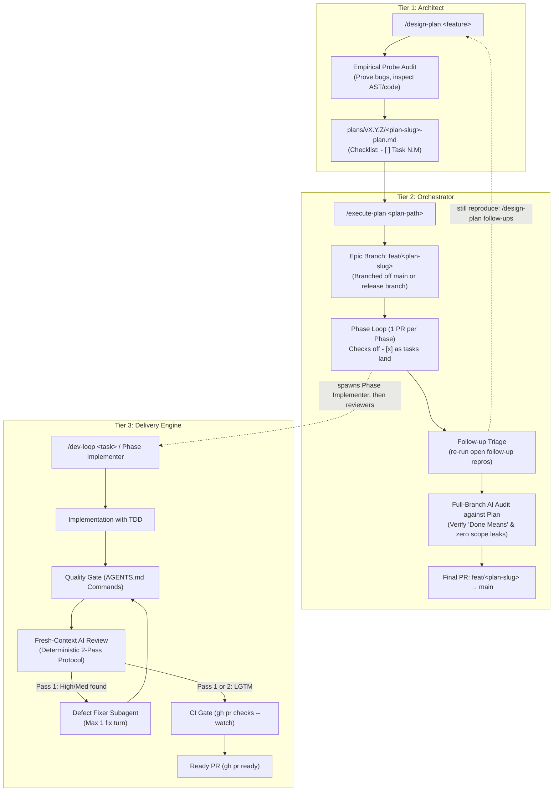
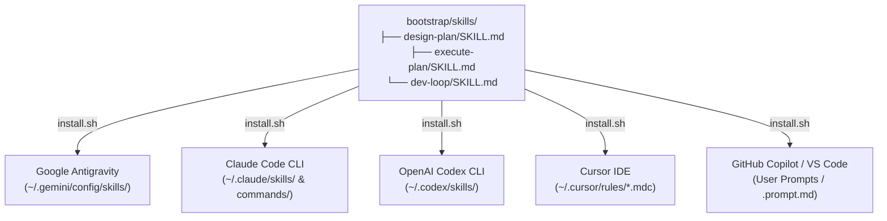

# Agentic Development Workflows & Skills Architecture

This document describes the design, operational lifecycle, and interaction model of the autonomous AI skills bundled with the **Agentic Development Bootstrap**.

---

## 1. Executive Summary: The 3-Tier Lifecycle

Autonomous AI development works best when responsibilities are separated into distinct operational tiers:



| Tier | Skill | Role | When to Use | Output |
| :--- | :--- | :--- | :--- | :--- |
| **1. Architect** | [`/design-plan`](#1-design-plan-the-architect) | **Pre-implementation** | Complex features, architectural migrations, multi-component refactors | Exhaustive plan document (`plans/vX.Y.Z/<plan-slug>-plan.md`) with probe evidence & task checklist |
| **2. Orchestrator** | [`/execute-plan`](#2-execute-plan-the-orchestrator) | **Multi-phase execution** | Once a design plan is approved | Creates epic branch, coordinates phased PRs, updates `- [x]`, conducts pre-merge branch audit |
| **3. Delivery Unit** | [`/dev-loop`](#3-dev-loop-the-delivery-engine) | **Single-task execution** | Targeted bugfixes, standalone tasks, or driven by `/execute-plan` | Feature branch, TDD, quality gate, draft PR, isolated AI review & fix, published PR |

---

## 2. The Skills in Brief

Each skill's `SKILL.md` is the authoritative, step-by-step specification; this section only states what each one is for and how to call it. Conventions shared by all three (target discovery, subagent dispatch, probes, safe commits, CI wait, the follow-up ledger) are defined once in `dev-loop/SKILL.md`.

### 1. `/design-plan` (The Architect)
Prevents shallow, hallucinated planning: probes the codebase to prove every claimed gap, fixes scope in a boundary matrix (every excluded item with its reason), writes falsifiable "Done means" criteria, and breaks the work into phases sized for one AI-reviewed PR each (3–5 tasks, each with `Files:` / `Test:` / `Done when:`). Links the plan in `plans/roadmap.md`.

`/design-plan follow-ups [<plan-path>]` re-probes the entries of `plans/follow-ups.md` (bugs reviewers found outside their diff), drops the ones already fixed, and moves the rest into a plan as fix phases or deferred items, so the ledger only ever holds open bugs.

```text
/design-plan Add WebSocket reconnection protocol with exponential backoff
/design-plan in gofront: Implement encoding/csv stdlib package
/design-plan follow-ups plans/v1.8.0/portable-go-plan.md
```

### 2. `/execute-plan` (The Orchestrator)
Runs an approved plan on an epic branch `feat/<plan-slug>`, one phase at a time: a **Phase Implementer** subagent runs `/dev-loop` (implement-only) on `feat/<plan-slug>-phase-<N>`, then the orchestrator runs the `/dev-loop` review cycle on that PR. The plan's `- [x]` checklist is the durable state, so an interrupted run resumes at the next unchecked task. Default mode stops after each phase PR is ready for you to merge; `--auto` merges passing phases itself (merge commit) and continues. When every task is done it triages open follow-ups (halting to ask if any still reproduce), has a **Plan Auditor** subagent verify the whole branch against "Done means" and the boundary matrix, marks the plan `Completed`, and opens the final PR into `main`.

```text
/execute-plan plans/v1.8.0/portable-go-plan.md
/execute-plan --auto plans/v1.8.0/portable-go-plan.md
/execute-plan --auto in gofront
```

### 3. `/dev-loop` (The Delivery Engine)
Takes a standalone task or a plan phase from failing test to a ready PR: TDD implementation, the `AGENTS.md` quality gate, one plain-language changelog entry, a draft PR, then a deterministic review protocol run entirely by fresh-context subagents (never self-review): Pass 1 review with verification probes → at most one **Defect Fixer** turn for High/Medium findings → Pass 2 verification, hard-stopped after two passes. Pre-existing defects the reviewer notices go to the follow-up ledger `plans/follow-ups.md` with a repro instead of being fixed out of scope. The PR is marked ready only when review and CI are both clean; otherwise it stays a draft with the findings in its body.

```text
/dev-loop Fix the race condition in session cleanup
/dev-loop in gofront: Add benchmark for AST token parsing
```

---

## 3. Multi-Vendor AI Deployment

The skills are designed to follow open standards so you can switch between AI development tools without changing your workflow:



### Tested Environments
| Tool | Status | Subagent Execution |
|---|---|---|
| Google Antigravity (`agy`) | **Tested** | `invoke_subagent`; `/execute-plan` spawns the Phase Implementer and reviewers directly. |
| Claude Code (`claude`) | **Tested** | `Agent` tool (`general-purpose`); same flat flow, which fits Claude Code's rule that subagents cannot spawn subagents. |
| Codex, Cursor, Copilot | Installed, untested | If the host offers a fresh-context subagent tool, the skills use it via the generic dispatch row. Without one, implementation runs inline and the review step halts: the PR stays Draft with `REVIEW_STATUS=PENDING_REVIEW` (never self-review). |

### Installation
Running `./install.sh` from `bootstrap`:
```bash
cd ~/dev/bootstrap
./install.sh
```
The installer automatically inspects your machine:
- Detects installed AI tools (`agy`, `claude`, `codex`, `cursor`, `code`).
- Installs skills only for tools present on the system.
- Converts prompts into native formats (MDC rules for Cursor, Prompt files for Copilot, Agent Skills for Antigravity/Claude/Codex) and fills in each host's installed `dev-loop` path where subagent prompts need to read it.
- Cleanly skips absent tools without creating clutter.

---

## 4. Relationship with Project Repositories

```text
~/dev/bootstrap/                     <-- Global Agentic Headquarters
├── install.sh                       <-- Installs /design-plan, /execute-plan, /dev-loop globally
├── sync.sh                          <-- Syncs scaffold/AGENTS.md Part 1, bridge files, plan template + managed .gitignore block to sibling projects
├── skills/                          <-- Global skill definitions (never copied to projects)
└── scaffold/                        <-- Pristine project starter kit (copied into new projects)
    ├── AGENTS.md
    ├── CHANGELOG.md (clean starter template)
    ├── CLAUDE.md, .github/copilot-instructions.md (bridge files → AGENTS.md; Cursor reads AGENTS.md natively)
    ├── .gitignore (agentic ignores inside the bootstrap-managed block)
    ├── lefthook.yml
    └── plans/ (roadmap.md, template.md, follow-ups.md starters)

~/dev/gofront/                       <-- Sibling Project Repository
├── AGENTS.md                        <-- Part 1 synced from bootstrap; Part 2 project context + Commands
├── .gitignore                       <-- bootstrap-managed block synced; project ignores outside it untouched
├── lefthook.yml                     <-- Pre-commit quality gate
├── CHANGELOG.md                     <-- Maintained by /dev-loop and /execute-plan
├── docs/                            <-- Human documentation only; never touched by the skills
└── plans/                           <-- Everything the skills read and write
    ├── template.md                  <-- Synced from bootstrap
    ├── follow-ups.md                <-- Follow-up ledger: written by /dev-loop reviewers and any agent session, scheduled by /design-plan follow-ups
    ├── roadmap.md                   <-- Maintained by /design-plan and /execute-plan
    └── v1.8.0/                      <-- Plans authored by /design-plan, executed by /execute-plan
        └── portable-go-plan.md
```

- **Clean Repositories:** Sibling projects (`gofront`, `simplefps`, etc.) contain zero tool-specific skill directories.
- **Single Source of Truth:** `AGENTS.md` governs agent behavior across all tools. Its `Commands` section is the quality gate every skill and reviewer runs.
- **Zero Drift:** Updating the skill or rules in `bootstrap` keeps the entire workstation's agent fleet synchronized.
